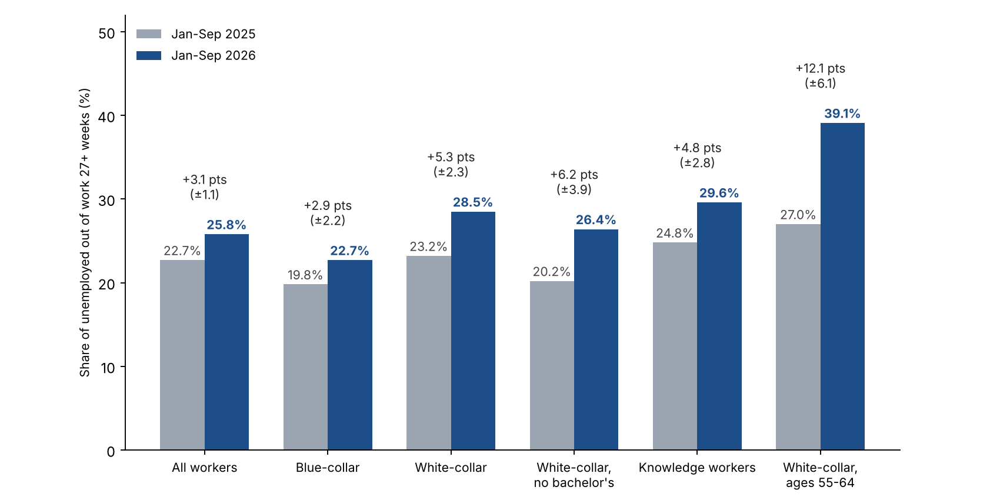

# October 2026 White Collar Employment Report

*Draft v10. Covers October 2026 data; to be published in November 2026. Not published or sent.*

## Hiring improved in October, but more unemployed white-collar workers are in long spells than a year ago

Employers added 165,000 jobs in October and unemployment fell to 4.1% (BLS, seasonally adjusted). Yet among unemployed white-collar workers, 28.5% had been unemployed for 27 weeks or more in January to September 2026, up from 23.2% in the same months of 2025. Among knowledge workers (white-collar occupations with a bachelor's degree or more) the share is 29.6%, up from 24.8%; among white-collar workers aged 55 to 64 it is 39.1%, up from 27.0%. All three increases are larger than their 90% margins of error on the year-over-year changes (about ±2.3, ±2.8 and ±6.1 percentage points, BLS generalized-variance method), and they also clear a more conservative approximation (about ±3.4, ±4.3 and ±8.8).

 The white-collar unemployment rate itself is low, 2.63% against 2.48% a year earlier, so the squeeze shows up in the share of unemployed workers already out 27 weeks or more, not in how many people are out of work. The seasonally adjusted White-Collar Long-Search Index (2019 = 100, three-month average) was 153 in September, down from 162 in August and a peak of about 170 in June, but still above the 135 of September 2025; the 90% margin of error on the three-month index is about ±11% of its level (roughly ±17 points), so the gap with a year ago is not distinguishable from sampling noise on its own and we rely on the nine-month comparison above. A single month's reading is noisier still (roughly ±24 points). Long-term unemployed workers are about 0.75% of the white-collar labor force, up from about 0.58% (the unemployment rate times the long-term share, our calculation).

*What it means for a job seeker:* Economy-wide openings per unemployed person are up from a year ago (not a white-collar-specific measure), so there is more to apply to. At the same time, long-duration unemployment has become more prevalent among unemployed white-collar workers: the share whose ongoing spell has lasted at least 27 weeks rose from 23.2% to 28.5%. This measures ongoing spells rather than the probability that a newly unemployed worker will remain out six months, but job seekers should still plan for the possibility of a prolonged search.

*Method note:* the CPS measures how long people have been unemployed so far, not whether they are actively searching. Margins of error use the BLS generalized-variance method with BLS's published CPS parameters, as in the September edition; for subgroups we apply the parameters for all unemployed people, which can understate variance for small groups, so we also check each result against a more conservative rule (design effect 2.0, pooled months counted as 40% independent). Census October microdata are not yet published, so occupation-level figures run through September, while payrolls and unemployment are October and JOLTS and CPI are September.

## Who we mean: white-collar, professional, college-educated and knowledge workers

These groups overlap; they are not nested.

- **White-collar:** people whose current or most recent job is in Census occupation group 1 (management, business and financial) or 2 (professional and related). Same definition as September.
- **College-educated:** people with a bachelor's degree or more, in any occupation.
- **Knowledge workers (our working definition):** white-collar occupation and a bachelor's degree or more. There is no official definition; the term is used for workers whose main input is expertise and judgment, and this is a measurable overlap of the other two.

Share of employed people, January to September 2026 monthly average (Census CPS, not seasonally adjusted):

| Group | Employed (thousands) | Share of all employed |
|---|---:|---:|
| All employed | 162,655 | 100% |
| White-collar occupations | 71,389 | 43.9% |
| Bachelor's degree or more, any occupation | 68,539 | 42.1% |
| Knowledge workers (both) | 49,913 | 30.7% |
| White-collar without a bachelor's degree | 21,476 | 13.2% |
| Blue-collar occupations (Census groups 7 to 10) | 32,853 | 20.2% |

Knowledge workers are about 70% of employed white-collar workers and about 73% of employed college graduates.

| Group, January to September | Unemployment rate 2026 | 2025 | Share of unemployed out 27+ weeks 2026 | 2025 | Median weeks unemployed 2026 | 2025 |
|---|---:|---:|---:|---:|---:|---:|
| All workers | 4.32% | 4.30% | 25.8% | 22.7% | 11 | 9 |
| White-collar | 2.63% | 2.48% | 28.5% | 23.2% | 12 | 9 |
| Bachelor's or more (any occupation) | 3.01% | 2.86% | 29.3% | 26.0% | 12 | 12 |
| Knowledge workers | 2.54% | 2.32% | 29.6% | 24.8% | 13 | 10 |
| White-collar without a bachelor's | 2.85% | 2.85% | 26.4% | 20.2% | 11 | 8 |
| Blue-collar | 4.95% | 5.04% | 22.7% | 19.8% | 9 | 8 |

Note: Unweighted unemployed respondents, 2026 / 2025: all workers 15,822 / 16,915; white-collar 4,315 / 4,417; knowledge workers 2,861 / 2,856; white-collar without a bachelor's 1,454 / 1,561; bachelor's or more 4,614 / 4,662; blue-collar 3,765 / 4,023; white-collar ages 55 to 64 768 / 763.

White-collar workers aged 50 and over: 37.0% out 27+ weeks vs 29.5%, median 16 weeks vs 12. Ages 55 to 64: 39.1% vs 27.0%, median 18 weeks vs 12 (768 unemployed respondents in 2026). White-collar workers without a bachelor's degree show the same year-over-year rise with no change in unemployment: their unemployment rate was 2.85% in both years, while the share out 27+ weeks rose 6.2 points, from 20.2% to 26.4% (±3.9 points by the BLS method and ±5.7 by the conservative rule; it clears both). The rise for knowledge workers was 4.8 points; the difference between the two groups' increases is within the margin of error, so we do not say one group is worse off. We make no claim about the 0.15-point rise in the white-collar unemployment rate; it is small and we have not tested it. Not seasonally adjusted; October CPS is not published yet.

## Why white-collar and professional work matters for the middle class

Blue-collar job loss has long drawn attention, for good reason: a plant closure hits a town at once. White-collar and professional work is now the larger part of the workforce, and the way it is lost is different.

- **It is a large share of work, and the strain shows up in duration, not the headline rate.** White-collar occupations are 43.9% of employed people and knowledge workers 30.7%, against 20.2% in blue-collar occupations. White-collar unemployment is 2.63% against 4.95% for blue-collar, yet 28.5% of unemployed white-collar workers have been out 27+ weeks, against 22.7% for blue-collar, and the share has also risen for blue-collar workers, by less (+2.9 points against +5.3; the blue-collar rise clears the BLS margin but not the more conservative one) (Census CPS, January to September 2026).
- **Losses can be long-lasting.** Lachowska, Mas and Woodbury (2020), using Washington State records, find earnings about 16% below those of comparable workers five years after a job loss (NBER working-paper version). Davis and von Wachter (2011) find that over 20 years the loss averages 1.4 years of prior earnings when a layoff happens while unemployment is under 6%, and 2.8 years when it is above 8%. Schwerdt, Ichino, Ruf, Winter-Ebmer and Zweimüller (IZA, 2008), using Austrian plant closures, find long-run effects that are weak for blue-collar workers but strong and persistent for white-collar workers, consistent with firm-specific skills mattering more in white-collar jobs. These are studies of past periods and specific groups.
- **Many do recover.** The BLS survey of workers who lost jobs found that 66.1% of long-tenured workers who lost jobs in 2023 to 2025 were working again by January 2026, and about half of those earned as much as before (BLS, August 2026). Recovery is the common outcome; the cost is in time and, for many, pay.
- **The middle class leans on this work, and the losses are spread out.** Pew Research Center (2022) found the share of adults in middle-class households fell from 61% in 1971 to 50% in 2021, and that 39% of adults with at least a bachelor's degree were in the upper-income tier in 2021, against 16% or less of those without a degree. A job lost by a household's main earner affects income, employer health coverage and the ability to carry a mortgage at once, and a longer spell lengthens each. White-collar cuts also come from many employers and metros rather than one plant in one town, so they seldom appear as a single local event (our reading, not a finding).

*What it means for a job seeker:* Among unemployed white-collar workers, a larger share has already been out of work for at least 27 weeks than a year ago. Job seekers should account for the possibility of a prolonged search, planning savings, health coverage and a wider set of target employers and metros from day one.

This section describes what the data show about white-collar and professional work; it makes no claim that AI or any other single cause explains them.

## What changed in the story this month

- **From "AI" to "the economy" in layoff announcements.** Challenger says AI dominated announced-cut reasons through spring and summer, while in the fall employers more often cite market and economic conditions, now the top reason for 2026. That is what employers say; it does not show what caused any cut.
- **From low-hire, low-fire to a hiring pickup.** September looked "soft, but not dire" (Employ America) and "steadiness without a spark" (Indeed). October beat expectations, though announced hiring is mostly seasonal (72% of 2026 hiring plans, Challenger).
- **From rate cuts to possible hikes.** Employ America's base case moved from easing to a hold to a hike, with an energy shock lifting inflation (CNN).
- **Early-career workers remain the open question.** The Stanford Digital Economy Lab's August 2026 update puts employment of 22- to 25-year-olds in the most AI-exposed occupations 19% below comparable peers, up from 15% a year earlier; the authors treat this as an early indicator, not proof of cause. Yale's Budget Lab (Oct 14) found no clear economy-wide disruption from AI in September data. Indeed finds advertised pay rising fastest in the most AI-exposed occupations (about 46% since 2021, against about 25% in the least-exposed occupations).
- **Voluntary exits instead of layoffs, at the largest employers.** Microsoft and Google both used voluntary exit offers this year (below).

*What it means for a job seeker:* Hiring conditions remain uneven: layoffs and voluntary exits are concentrated in specific sectors, while information and financial activities continue to contract.

## Bright spots

Reference periods differ by row: payrolls and unemployment are October, JOLTS is September, Challenger is October announcements (not seasonally adjusted). Seasonally adjusted unless noted.

| Measure | Latest | Comparison | Source |
|---|---|---|---|
| Payrolls, October (seasonally adjusted) | +165,000 (+0.1% m/m; +0.6% y/y) | about 65,000 expected; August revised to +186,000 and September to +60,000 | BLS |
| Unemployment rate, October | 4.1% | 4.2% in September | BLS |
| Job openings, September (economy-wide) | 7.52 million (+4.6% m/m) | August revised to 7.19 million; BLS describes the monthly change as little changed | BLS JOLTS |
| Openings per unemployed person, September (economy-wide) | 1.06 | 1.02 in August; 0.94 a year earlier | BLS (our calculation) |
| Layoff rate, September (economy-wide) | 1.0% | 1.1% in August; BLS describes the change as small | BLS JOLTS |
| Quits rate, September (economy-wide) | 2.1% | 1.9% in August; BLS shows 197,000 of the roughly 321,000 rise was in accommodation and food services; quits elsewhere still rose 124,000 | BLS JOLTS |
| Professional and business services, October | +70,000 (+0.3% m/m; +1.2% y/y) | professional, scientific and technical +33,000 | BLS |
| Announced layoffs, October (not seasonally adjusted) | 43,994 | down 71% from October 2025; lowest October since 2023 (36,836) | Challenger |
| Indeed Job Postings Index, Oct 16 (Feb 2020 = 100, seasonally adjusted) | 103.8 (+2.8% y/y) | new postings flat over the month (99.2) | Indeed Hiring Lab |

Payroll gains over January to October 2026 total 861,000 on current revisions (BLS).

*What it means for a job seeker:* Demand is broader than a month ago (68% of occupational sectors are above year-ago postings, Indeed), but new postings are flat over the month, so the flow of fresh listings has not picked up.

## Clouds

Reference periods differ by row: wages and sector payrolls are October, prices and JOLTS are September, ECI is Q3 (twelve months to September), and Challenger is January to October. Seasonally adjusted unless noted.

| Measure | Latest | Comparison | Source |
|---|---|---|---|
| Wages vs prices | wages +3.1% y/y (October); consumer prices +3.7% y/y (September, not seasonally adjusted) | different months; prices +0.6% in September | BLS |
| Information employment, over the year (seasonally adjusted) | -4.2% (-119,000) | total payrolls +0.6% | BLS |
| Financial activities employment, over the year (seasonally adjusted) | -1.1% (-99,000) | | BLS |
| Hires rate, September | 3.4% | 3.3% in August | BLS JOLTS |
| Announced hiring plans (Challenger, 2026) | 72% seasonal | concentrated in five companies | Challenger |
| Technology announced cuts, January to October | 171,501 | up 21% from 141,159 in the same months of 2025 | Challenger |
| Employer health-benefit costs vs wages, twelve months to Q3 | health benefits +6.4%; wages +3.1% | KFF 2026: single-coverage premium +5% to $9,804; family worker contribution +9% to $7,471 | BLS Employment Cost Index (via Employ America); KFF |

Seattle, San Francisco and Santa Rosa have among the lowest local postings indexes in the country (Indeed).

*Rates:* before the report, Employ America's base case was a Federal Reserve rate increase in December and another in March. A strong report can raise those odds, and higher borrowing costs tend to slow hiring over time. That is one forecaster's view, not a certainty.

*What it means for a job seeker:* The pressure is in information, finance and technology roles and in October wage growth (+3.1% y/y) that trails the latest September inflation reading (+3.7% y/y); look at sectors adding jobs (professional services, health care) alongside the one you know.

## Layoffs and voluntary exits

- **Microsoft:** voluntary exit offers to about 60,000 employees, announced Oct 26. The 60,000 is the number eligible, about a quarter of the workforce, up to level 70 in the U.S., Canada, the U.K. and India, in participating organizations only. Microsoft reportedly anticipates under 5% will accept. The 60,000 and the eligibility details are as reported by CNBC, GeekWire, Fortune and Windows Central, not an official figure we could read. Challenger records voluntary programs by actual acceptances or a stated target, so these offers are not in its October total, and notes they often signal more layoffs.
- **Google:** confirmed to Reuters on Nov 4 that it expanded voluntary exit offers in June 2026 to employees in Canada, France, Germany, Japan and Switzerland, following U.S. rounds that began in 2025. Participation has not been disclosed, and some units (Cloud, DeepMind) have been excluded.
- **Squarespace:** about 300 employees, 19% of staff, confirmed by the company (TechCrunch, Nov 2).
- **Amazon:** fewer than 1,000 corporate roles, mainly in its Stores division, confirmed Oct 7 (Reuters).
- **Disney:** a WARN filing for 159 theme-park workers in October.
- **Challenger on reasons:** AI was the stated reason for about 20% of announced cuts in 2026 (121,401 of 617,189) but only 1,265 in October, the lowest month of 2026; market and economic conditions are now the top reason. This is what employers say, not a finding that AI caused outcomes.

The full list of announcements we track is in NextChapter's layoff tracker; items there are reported by news outlets and not all are confirmed, so this section lists only company-confirmed announcements and filings.

*What it means for a job seeker:* a voluntary exit offer is a signal of restructuring, not a layoff, and the people who take them re-enter the market, often with a package that funds a longer search.

## Employers: who is hiring

Counts as of October 26, 2026, not seasonally adjusted, from NextChapter's daily count of verified open jobs on employer career sites and the job systems behind them: 487,679 jobs, of which 130,710 (27%) are entry-level or early-career. This is a different universe from the Anthropic section below, which uses open postings in our crawl as of November 6 (653,974, excluding postings that link through a job aggregator), including imported postings not yet verified, some of which may no longer be open. These are all functions and levels, entry-level included; the Census white-collar test is not applied, so the counts are never combined with the white-collar figures above. A ranking shows who has the most open jobs among the jobs we track, not who hires most in the economy and not how good an employer is. Coverage is partial and follows our sources.

**Most entry-level jobs (roughly 0 to 3 years of experience)**

| # | Employer | Entry-level | Open |
|---:|---|---:|---:|
| 1 | Amazon | 2,140 | 9,460 |
| 2 | SpaceX | 1,124 | 2,211 |
| 3 | Cintas | 615 | 714 |
| 4 | Albertsons Companies | 496 | 588 |
| 5 | Anduril Industries | 474 | 1,913 |
| 6 | CACI International | 434 | 1,777 |
| 7 | Lockheed Martin | 429 | 1,385 |
| 8 | JPMorgan Chase | 428 | 2,891 |
| 9 | RTX | 428 | 1,539 |

Safeway, an Albertsons brand, is listed separately by the source at 458 entry-level of 546 open.

**Most jobs that need no experience (the posting says so):** Rollins 171; Unifirst 116; AT&T 98; Dewberry 78; Langan 59; SpaceX 42; Kiewit Infrastructure West 27; Bechtel Energy 26; AML RightSource 24; AIL 22.

**Employers asking for AI skills** (the posting names a specific AI skill or tool; this describes what postings ask for, not what caused any hiring or cut)

| Employer | Jobs asking for AI skills | Share of its open jobs |
|---|---:|---:|
| Amazon | 2,487 | 26% |
| Nvidia | 407 | 50% |
| Salesforce | 346 | 54% |
| Anthropic | 343 | 61% |
| Intuit | 341 | 50% |
| Capital One | 326 | 25% |
| Crusoe | 325 | 96% |
| OpenAI | 303 | 45% |
| Accenture | 292 | 45% |
| Google | 280 | 14% |

**Top employers by function** (total open jobs in the function; for engineering the parentheses show entry-level and AI-skill counts)

| Function (open jobs) | Top employers |
|---|---|
| Engineering (109,438) | Amazon 3,202 (1,144 entry-level; 600 AI); Northrop Grumman 1,533 (134; 17); Anduril 1,309 (354; 125); SpaceX 1,288 (786; 56); RTX (Raytheon) 1,104 (365; 28) |
| Operations (57,301) | Amazon 1,572; EoS Fitness 479; Uline 468; JLL 271; SpaceX 243 |
| Sales (54,425) | Charter Communications 465; Cintas 421; Amazon 409; PNC 247; Orkin 240 |
| Finance (36,565) | Amazon 530; BDO USA 339; KPMG 308; Deloitte 263; Baker Tilly 250 |
| Data and analytics (28,048) | Amazon 799; Google 361; JPMorgan Chase 357; Deloitte 277; Capital One 259 |
| Marketing (17,745) | Amazon 254; Maximus 116; Greystar 101; Google 91 |
| Human resources (16,021) | Amazon 308; Anduril 72; SpaceX 71; Arthur J. Gallagher 69 |
| Legal (14,308) | State of Florida 208; Morgan & Morgan 196; Lewis Brisbois 152; Amazon 104 |
| Investment (6,208) | JPMorgan Chase 573; Merrill (a Bank of America business) 159; Morgan Stanley 146; Equitable 99; PNC 64 |

Method: staffing and search firms are excluded; employers are matched by name and duplicate entries for one company are counted once; one employer whose thousands of postings could not yet be confirmed as distinct jobs is left out until checked. Our employer-level history starts in October 2026, so no month-over-month or year-over-year claim is made for any employer, and no employer is shown here in connection with layoffs. The full top-15 tables for all 21 functions are in the data download.

*What it means for a job seeker:* the employers with the most open jobs are a starting list of where volume is, not a measure of fit; use the function tables to find who hires for your role.

## AI exposure and the jobs we see open (Anthropic Economic Index)

We matched job titles on open postings NextChapter tracks (as of November 6) to occupations in the Anthropic Economic Index. Its score runs from 0 to 1 and is the share of an occupation's tasks that Claude is observed doing in work usage, limited to tasks a language model could plausibly speed up. So 0.30 means 30% of the occupation's tasks. The score describes tasks, not job loss, and says nothing about whether AI caused any hiring or layoff. Anthropic, Microsoft and OpenAI are AI developers and the authors of these measures, and NextChapter also uses AI tools to produce this report.

| Exposure of matched open postings | Share |
|---|---:|
| No observed exposure (0) | 3.7% |
| Under 0.10 | 19.4% |
| 0.10 to 0.29 | 38.5% |
| 0.30 or higher | 38.5% |

Note: Covers 89,447 matched postings out of 653,974 open postings crawled as of Nov 6, 2026. Postings that link through a job aggregator are excluded; about 86% of the rest were loaded in bulk from employer career sites and job systems, are not individually verified, and some may no longer be open.

- **Coverage:** 89,447 of 653,974 open postings (13.7%) matched an occupation; the rest are not forced into one. The matched set leans toward professional and management titles. Counts are postings we crawl, not all U.S. openings; cells under 100 postings are not shown.
- **Highest-scoring occupations with 100 or more open postings:** market research analysts and marketing specialists (0.65; 690 open), financial and investment analysts (0.57; 3,246), information security analysts (0.49; 1,181), technical writers (0.47; 227), data scientists (0.46; 3,583), secretaries and administrative assistants (0.45; 3,673), operations research analysts (0.43; 114).
- **By function (average score of matched postings):** data and analytics 0.46, finance 0.38, marketing 0.38, administration 0.36, human resources 0.31, legal 0.23, engineering 0.21.
- **Cross-check:** the unweighted Spearman rank correlation across the 756 overlapping occupations is 0.58 with Microsoft's applicability scores and 0.70 with OpenAI's exposure ratings: broad agreement, not close, so we show bands, not precise rankings.
- **Match quality:** we reviewed all 200 sampled matches by hand. 4 (2%) looked wrong (for example a development manager matched to training and development managers, and a school president matched to general and operations managers). Another 15 (7.5%) were judgment calls between neighboring occupations: machine learning engineers, DevOps and site-reliability engineers, and software engineering managers. These matter because the neighboring occupations score differently, so averages for engineering-adjacent titles are the least certain figures in this section.
- **Change over time:** not reported. Our postings history starts in mid-October 2026, and the exposure file used is Anthropic's October 22 version; a comparison with the current file on November 6 found the values for all 497 occupations in SOC groups 11 to 43 unchanged.

*What it means for a job seeker:* exposure describes how much of a job's tasks AI tools are observed doing, which is a reason to build fluency with those tools, not a prediction that the job will go away.

## The new Congress

Democrats won both chambers on November 3 (AP). Analysts expect a federal push to override state AI laws to lose momentum and more oversight hearings, and expect major technology legislation to be unlikely in 2027 without bipartisan votes (NatLawReview, Roll Call). On the economy, analysts flag a higher chance of budget standoffs and a debt-limit deadline around mid-to-late summer 2027, while divided government makes large tax or trade changes harder (PGIM, BNP Paribas Fortis, ICICI Bank). These are analysts' readings, not forecasts of ours.

*What it means for a job seeker:* Congress does not set interest rates or hiring decisions; the nearer-term channels are government funding deadlines and the debt limit, which matter most for contractors and federal-adjacent employers, and the pace of any workforce-training bills.

## Appendix: other reference points (secondary and vendor data)

- **Security hiring (a16z, Oct 28).** A survey of 100 chief information security officers at companies with 1,000 or more employees: 87% expect cybersecurity spending to rise; nearly half expect security headcount to rise, about half flat, 4% expect cuts; 18% have AI security-operations tools in production. a16z is an investor in the space, the survey is self-reported with 100 respondents, and we have not checked the methodology.
- **Where people get interviews (Huntr, Oct 7).** In Huntr's own user data, applying on a company's careers page led to an interview 6.87% of the time versus 1.95% through job boards. Vendor data, not independently checked.
- **Corporate AI payoff (Apollo, Daily Spark).** Chief economist Torsten Slok writes that revenue per worker and profit margins are rising for the seven largest tech companies and flat for the other roughly 493 in the S&P 500, with no sign of an AI lift to productivity growth. Commentary; not independently checked.
- **Reminder on sources:** figures drawn from Employ America, Indeed Hiring Lab, Apollo and news reports are as reported by those sources.
