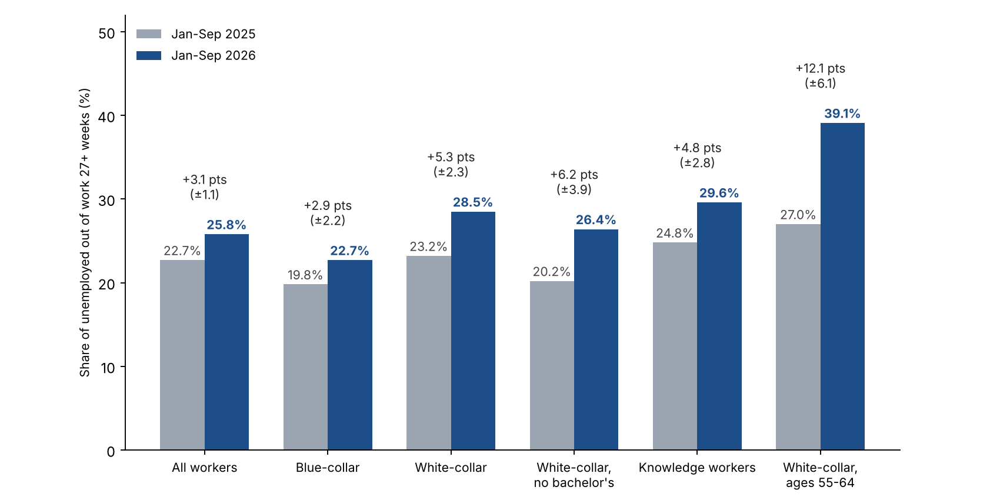

# October 2026 White Collar Employment Report

*Version 1.3. Covers October 2026 data; to be published in November 2026. Not published or sent.*

## Hiring improved in October, but more unemployed white-collar workers are in long spells than a year ago

Employers added 165,000 jobs in October and unemployment fell to 4.1% (BLS, seasonally adjusted). Yet among unemployed white-collar workers, 28.5% had been unemployed for 27 weeks (about six months) or more in January to September 2026, up from 23.2% in the same months of 2025. The share is highest, and rose most, among workers aged 55 to 64: 39.1%, up from 27.0%. Among knowledge workers (white-collar occupations with a bachelor's degree or more) it is 29.6%, up from 24.8%. All three increases are larger than their 90% margins of error on the year-over-year changes (about ±2.3, ±2.8 and ±6.1 percentage points, BLS generalized-variance method), and they also clear a more conservative approximation (about ±3.4, ±4.3 and ±8.8).

Two limits on what this shows. First, long spells also became more common for blue-collar workers (+2.9 points) and for all workers (+3.1). White-collar workers' +5.3 is not shown to be larger: the difference from blue-collar is 2.4 points against a margin of about ±3.2, so we do not say white-collar workers are worse off than others. What does clearly differ is the level: 28.5% of unemployed white-collar workers are in long spells against 22.7% for blue-collar workers (difference 5.8 points, margin about ±2.4). Second, at ages 55 to 64 the white-collar rise (+12.1) is not distinguishable from the all-worker rise at those ages (+5.9; difference 6.2 against about ±7.1), though the white-collar level is higher (39.1% against 30.5%; margin about ±5.3).

 The white-collar unemployment rate itself is low, 2.63% against 2.48% a year earlier, so the squeeze shows up in the share of unemployed workers already out 27 weeks or more, not in how many people are out of work. The seasonally adjusted White-Collar Long-Search Index (2019 = 100, three-month average) was 153 in September, down from 162 in August and a peak of about 170 in June, but still above the 135 of September 2025; the 90% margin of error on the three-month index is about ±11% of its level (roughly ±17 points), so the gap with a year ago is not distinguishable from sampling noise on its own and we rely on the nine-month comparison above. A single month's reading is noisier still (roughly ±24 points). Long-term unemployed workers are about 0.75% of the white-collar labor force, up from about 0.58% (the unemployment rate times the long-term share, our calculation).

*Our reading, not a finding: slower exits and fewer people entering unemployment, more than more layoffs.* The unemployment rate barely moved while the share in long spells rose five points. That pattern is what you would see if fewer new people were becoming unemployed and those already unemployed were leaving a little more slowly, since fewer short spells shrink the base the long spells are measured against. We tested this by matching the same people in consecutive months of the CPS (January to September, eight month-to-month pairs, about 415,000 matched people in 2026). Among unemployed white-collar workers, 25.3% were employed the next month, against 27.7% a year earlier (-2.4 points, margin about ±4.5), and among those out 27+ weeks, 13.2% against 16.4% (-3.2, margin ±7.3). Among employed white-collar workers, 0.63% were unemployed the next month, against 0.71% (-0.08, ±0.13); for all workers the entry rate fell from 0.97% to 0.86% (-0.11, ±0.10, a measurable decline). More white-collar layoffs would show up as a higher entry rate, and we do not see one. None of the white-collar changes is statistically distinguishable from zero on its own, so this is a direction consistent with the explanation, not proof of it. These flows use the monthly composite weight rather than longitudinal weights and are approximate in level; we compare the two years under the same method. Hiring improved in October, which could reverse the pattern; the October CPS file is not out yet.

*What it means for a job seeker:* Economy-wide openings per unemployed person are up from a year ago (not a white-collar-specific measure), so there is more to apply to. At the same time, long-duration unemployment has become more prevalent among unemployed white-collar workers: the share whose ongoing spell has lasted at least 27 weeks rose from 23.2% to 28.5%. This measures ongoing spells rather than the probability that a newly unemployed worker will remain out six months, but job seekers should still plan for the possibility of a prolonged search.

*Method note:* the CPS measures how long people have been unemployed so far, not whether they are actively searching. Margins of error use the BLS generalized-variance method with BLS's published CPS parameters, as in the September edition; for subgroups we apply the parameters for all unemployed people, which can understate variance for small groups, so we also check each result against a more conservative rule (design effect 2.0, pooled months counted as 40% independent). The month-to-month matching and its margins (design effect 2.0, transitions counted as 40% independent) are described in the methodology note. Census October microdata are not yet published, so occupation-level figures run through September, while payrolls and unemployment are October and JOLTS and CPI are September. This edition does not yet include the October CPS figures or the early-warning section on early-career and senior white-collar unemployment; both will be added when Census publishes the October file (listed for about November 19). The margin-of-error calculation is documented in the accompanying methodology note. As a check, the same pipeline reproduces BLS's published all-worker figures for these months: unemployment rate 4.32% in 2026 and 4.30% in 2025, and share out 27+ weeks of 25.8% against BLS's 25.9% (2026) and 22.7% against 22.6% (2025).

## Who we mean: white-collar, professional, college-educated and knowledge workers

These groups overlap; they are not nested.

- **White-collar:** people whose current or most recent job is in Census occupation group 1 (management, business and financial) or 2 (professional and related). Same definition as September.
- **College-educated:** people with a bachelor's degree or more, in any occupation.
- **Knowledge workers (our working definition):** white-collar occupation and a bachelor's degree or more. There is no official definition; the term is used for workers whose main input is expertise and judgment, and this is a measurable overlap of the other two.

Share of employed people, January to September 2026 monthly average (Census CPS, not seasonally adjusted):

| Group | Employed (thousands) | Share of all employed |
|---|---:|---:|
| All employed | 162,655 | 100% |
| White-collar occupations | 71,389 | 43.9% |
| Bachelor's degree or more, any occupation | 68,539 | 42.1% |
| Knowledge workers (both) | 49,913 | 30.7% |
| White-collar without a bachelor's degree | 21,476 | 13.2% |
| Blue-collar occupations (Census groups 7 to 10) | 32,853 | 20.2% |

Knowledge workers are about 70% of employed white-collar workers and about 73% of employed college graduates.

| Group, January to September | Unemployment rate, 2026 | Unemployment rate, 2025 | Share out 27+ weeks, 2026 | Share out 27+ weeks, 2025 | Median weeks in current spell, 2026 | Median weeks in current spell, 2025 |
|---|---:|---:|---:|---:|---:|---:|
| All workers | 4.32% | 4.30% | 25.8% | 22.7% | 11 | 9 |
| White-collar | 2.63% | 2.48% | 28.5% | 23.2% | 12 | 9 |
| Bachelor's or more (any occupation) | 3.01% | 2.86% | 29.3% | 26.0% | 12 | 12 |
| Knowledge workers | 2.54% | 2.32% | 29.6% | 24.8% | 13 | 10 |
| White-collar without a bachelor's | 2.85% | 2.85% | 26.4% | 20.2% | 11 | 8 |
| Blue-collar | 4.95% | 5.04% | 22.7% | 19.8% | 9 | 8 |

Note: Unweighted unemployed person-month observations (January to September pooled; the same person can appear in more than one month), 2026 / 2025: all workers 15,822 / 16,915; white-collar 4,315 / 4,417; knowledge workers 2,861 / 2,856; white-collar without a bachelor's 1,454 / 1,561; bachelor's or more 4,614 / 4,662; blue-collar 3,765 / 4,023; white-collar ages 55 to 64 768 / 763.

White-collar workers aged 50 and over: 37.0% out 27+ weeks vs 29.5%, median spell so far 16 weeks vs 12. Ages 55 to 64: 39.1% vs 27.0%, median spell so far 18 weeks vs 12 (768 unemployed person-month observations in 2026). White-collar workers without a bachelor's degree show the same year-over-year rise with no change in unemployment: their unemployment rate was 2.85% in both years, while the share out 27+ weeks rose 6.2 points, from 20.2% to 26.4% (±3.9 points by the BLS method and ±5.7 by the conservative rule; it clears both). The rise for knowledge workers was 4.8 points; the difference between the two groups' increases is within the margin of error, so we do not say one group is worse off. We make no claim about the 0.15-point rise in the white-collar unemployment rate; it is small and we have not tested it. Not seasonally adjusted; October CPS is not published yet.

## Why white-collar and professional work matters for the middle class

Blue-collar job loss has long drawn attention, for good reason: a plant closure hits a town at once. White-collar and professional work is now the larger part of the workforce, and white-collar job losses are often less concentrated in a single employer or location (our reading).

- **It is a large share of work, and the strain shows up in duration, not the headline rate.** White-collar occupations are 43.9% of employed people and knowledge workers 30.7%, against 20.2% in blue-collar occupations. White-collar unemployment is 2.63% against 4.95% for blue-collar, yet 28.5% of unemployed white-collar workers have been out 27+ weeks, against 22.7% for blue-collar, and the share has also risen for blue-collar workers, by less (+2.9 points against +5.3; the blue-collar rise clears the BLS margin but not the more conservative one; the 2.4-point gap between the two rises is within its margin, so we do not claim white-collar workers' rise is larger) (Census CPS, January to September 2026).
- **Losses can be long-lasting.** Lachowska, Mas and Woodbury (2020), using Washington State records, find earnings about 16% below those of comparable workers five years after a job loss (NBER working-paper version). Davis and von Wachter (2011) find that over 20 years the loss averages 1.4 years of prior earnings when a layoff happens while unemployment is under 6%, and 2.8 years when it is above 8%. Schwerdt, Ichino, Ruf, Winter-Ebmer and Zweimüller (IZA, 2008), using Austrian plant closures, find long-run effects that are weak for blue-collar workers but strong and persistent for white-collar workers, consistent with firm-specific skills mattering more in white-collar jobs. These are studies of past periods and specific groups.
- **Many do recover.** The BLS survey of workers who lost jobs found that 66.1% of long-tenured workers who lost jobs in 2023 to 2025 were working again by January 2026, and about half of those earned as much as before (BLS, August 2026). Recovery is the common outcome; the cost is in time and, for many, pay.
- **The middle class leans on this work, and the losses are spread out.** Pew Research Center (2022) found the share of adults in middle-class households fell from 61% in 1971 to 50% in 2021, and that 39% of adults with at least a bachelor's degree were in the upper-income tier in 2021, against 16% or less of those without a degree. A job lost by a household's main earner affects income, employer health coverage and the ability to carry a mortgage at once, and a longer spell lengthens each. White-collar cuts also come from many employers and metros rather than one plant in one town, so they seldom appear as a single local event (our reading, not a finding).

*What it means for a job seeker:* Among unemployed white-collar workers, a larger share has already been out of work for at least 27 weeks than a year ago. Job seekers should account for the possibility of a prolonged search, planning savings, health coverage and a wider set of target employers and metros from day one.

This section describes what the data show about white-collar and professional work; it makes no claim that AI or any other single cause explains them.

## Industry, age, new graduates and place

The table sets white-collar workers (Census occupation groups 1 and 2) beside all workers, by the industry of the job they last held and by age. Rows are January to September 2026 against the same months of 2025, not seasonally adjusted. The margin is the 90% margin of error on the change in the share out 27+ weeks (BLS generalized-variance method, as for Exhibit 1); a change larger than its margin is marked with an asterisk. Cells with fewer than 100 unemployed person-month observations in either year are not shown.

| Group | White-collar: unemployment rate, 2026 (2025) | White-collar: share out 27+ weeks, 2026 (2025) | White-collar: change, points (±margin) | All workers: unemployment rate, 2026 (2025) | All workers: change in share out 27+ weeks, points (±margin) |
|---|---:|---:|---:|---:|---:|
| Everyone | 2.63% (2.48%) | 28.5% (23.2%) | +5.3 (±2.3)* | 4.32% (4.30%) | +3.1 (±1.1)* |
| **Industry of last job** | | | | | |
| Information | 5.17% (4.64%) | 38.3% (25.2%) | +13.1 (±10.2)* | 5.25% (5.06%) | +5.9 (±8.2) |
| Financial activities | 2.21% (1.99%) | 31.8% (33.1%) | -1.3 (±8.7) | 2.36% (2.36%) | -1.0 (±6.1) |
| Professional and business services | 3.23% (2.91%) | 31.3% (25.3%) | +6.0 (±4.8)* | 4.08% (4.01%) | +3.1 (±3.3) |
| Education and health | 2.50% (2.29%) | 23.3% (19.2%) | +4.1 (±3.7)* | 3.18% (2.89%) | +2.9 (±2.7)* |
| Public administration | 1.70% (1.58%) | 28.4% (19.2%) | +9.2 (±12.2) | 1.99% (1.75%) | +7.9 (±8.0) |
| **Age** | | | | | |
| Under 35 | 3.28% (3.05%) | 21.1% (17.3%) | +3.8 (±3.4)* | not shown | not shown |
| 35 to 44 | 2.09% (2.05%) | 27.8% (23.9%) | +3.9 (±5.0) | 3.28% (3.32%) | +2.1 (±2.8) |
| 45 to 54 | 2.32% (2.10%) | 32.5% (25.9%) | +6.6 (±5.4)* | 3.18% (2.99%) | +2.9 (±3.2) |
| 55 to 64 | 2.60% (2.47%) | 39.1% (27.0%) | +12.1 (±6.1)* | 2.94% (2.91%) | +5.9 (±3.6)* |

Note: unemployed person-month observations behind each white-collar row, 2026: everyone 4,315; information 237; financial activities 310; professional and business services 947; education and health 1,505; public administration 178; under 35 1,378; 35 to 44 900; 45 to 54 832; 55 to 64 768. Industry is the industry of the last job, and "white-collar" is the occupation of that job. Census CPS basic monthly microdata, NextChapter calculation. All-workers figures for under 35 are not shown because that age band is built from different groups elsewhere in our data.

- **White-collar unemployment is lower than the all-worker rate in every row.** In information the two are nearly equal (5.17% and 5.25%). We did not test whether the gaps in the rates are larger than sampling error, and we make no claim about them.
- **We do not show that white-collar spells lengthened more than all workers' spells.** In education and health, white-collar +4.1 points against all workers +2.9; at ages 55 to 64, +12.1 against +5.9. The differences between the two are within their margins (at ages 55 to 64, 6.2 points against about ±7.1). What is clear at ages 55 to 64 is the level: 39.1% of unemployed white-collar workers are in long spells against 30.5% of all unemployed workers that age.
- **Financial activities is the exception.** The share out 27+ weeks was flat to slightly lower for white-collar workers, even though payroll employment in the sector is down 1.1% over the year (BLS); the CPS measures those who report the sector as their last job, not payroll jobs, and the two are not the same.
- **Read the many-cell table with care.** Nineteen changes are tested at the 90% level, so about two would clear by chance alone if nothing had changed. The consistent direction across most rows is more informative than any single cell.

*What it means for a job seeker:* the longer spells show up across industries and ages, most clearly at ages 55 to 64 and in information and professional services, while finance looks different. A search plan should rest on your own field and age group, not on the average.

### Early-career workers and new graduates

- **Our data do not test the early-career story, and the older-age finding does not contradict it.** Press coverage of AI and jobs focuses on young workers. Our measure is the share of already-unemployed people in long spells, so it cannot see young people who are never hired into a first job, who stay in school or who leave the labor force; the research on early-career workers is about hiring and employment, not spell length. In our data the longest spells and the largest rises are at older ages, and white-collar workers under 35 have the shortest (21.1%, up from 17.3%; +3.8, margin ±3.4). Both can be true.
- **Recent graduates (ages 22 to 27 with a bachelor's degree or more, any occupation, our CPS calculation).** Unemployment 5.44% in January to September 2026 and in 2025, against 4.32% for all workers; 25.5% of the unemployed out 27+ weeks, up from 21.9% (+3.6, margin ±4.7, so not distinguishable from no change). The unemployment rate for all workers aged 16 to 24 was 9.36%, against 10.07% (not tested). Based on 766 unemployed person-month observations in 2026.
- **New York Fed (2026 Q3).** The unemployment rate for recent college graduates was 5.2%, which the Fed describes as a fall, and the underemployment rate (working in a job that does not typically need a degree) 42.5%, which it describes as ticking up. Press coverage reports a separate New York Fed study attributing much of the rise since 2019 to remote work; we have not read it.
- **Employer surveys and postings point different ways, as reported.** NACE's spring 2026 update projects employers will raise hiring of the class of 2026 by 5.6%, up from a 1.6% projection in November 2025; Handshake's August data show full-time postings down more than 16% from a year earlier and applications per job up 26% (secondary reports; we have not read the originals). Stanford's August update (above) finds employment of 22- to 25-year-olds in the most AI-exposed occupations 19% below comparable peers; the authors treat that as an early indicator, not proof of cause.
- **What open jobs show.** 130,710 of the 487,679 verified open jobs we track (27%) are entry-level or early-career (Employers chapter). We have no earlier counts to compare.

### Where jobs are growing and shrinking

BLS state data cover all industries, not white-collar jobs; we have no reliable state-level white-collar measure (state samples in the CPS are too small). For September 2026, BLS reports payroll gains over the month in New Jersey (+14,900) and South Carolina (+12,500), a decline in Wisconsin (-13,700), and little change in the rest. Over the year, the largest gains were in Texas (+154,300), California (+129,300) and North Carolina (+67,000), and the District of Columbia had the only significant loss (-25,800, -3.5%) and the highest unemployment rate (5.6%) (BLS, state release of October 20). Among metropolitan areas, Indeed's postings data show Seattle, San Francisco and Santa Rosa with the largest declines from February 2020 (about -35%, -37% and -32% as of October 2025, as reported); our own history of open jobs is too short to show place-level changes. BLS's October state release is scheduled for November 20.

## What changed in the story this month

- **From "AI" to "the economy" in layoff announcements.** Challenger says AI dominated announced-cut reasons through spring and summer, while in the fall employers more often cite market and economic conditions, now the top reason for 2026. That is what employers say; it does not show what caused any cut.
- **From low-hire, low-fire to a hiring pickup.** September looked "soft, but not dire" (Employ America) and "steadiness without a spark" (Indeed). October beat expectations, though announced hiring is mostly seasonal (72% of 2026 hiring plans, Challenger).
- **From rate cuts to possible hikes, which tend to slow hiring.** Employ America's base case moved from easing to a hold to a hike, with an energy shock lifting inflation (CNN).
- **Early-career workers remain the open question.** The Stanford Digital Economy Lab's August 2026 update puts employment of 22- to 25-year-olds in the most AI-exposed occupations 19% below comparable peers, up from 15% a year earlier; the authors treat this as an early indicator, not proof of cause. Yale's Budget Lab (Oct 14) found no clear economy-wide disruption from AI in September data. Indeed finds advertised pay rising fastest in the most AI-exposed occupations (about 46% since 2021, against about 25% in the least-exposed occupations).
- **Voluntary exits instead of layoffs, at the largest employers.** Microsoft and Google both used voluntary exit offers this year (below).

*What it means for a job seeker:* Hiring conditions remain uneven: layoffs and voluntary exits are concentrated in specific sectors, while information and financial activities continue to contract.

## Bright spots

Reference periods differ by row: payrolls and unemployment are October, JOLTS is September, Challenger is October announcements (not seasonally adjusted). Seasonally adjusted unless noted.

| Measure | Latest | Comparison | Source |
|---|---|---|---|
| Payrolls, October (seasonally adjusted) | +165,000 (+0.1% m/m; +0.6% y/y) | about 65,000 expected; August revised to +186,000 and September to +60,000 | BLS |
| Unemployment rate, October | 4.1% | 4.2% in September | BLS |
| Job openings, September (economy-wide) | 7.52 million, up 333,000 from August | August revised to 7.19 million; BLS describes the level as little changed | BLS JOLTS |
| Openings per unemployed person, September (economy-wide) | 1.06 | 1.02 in August; 0.94 a year earlier | BLS (our calculation) |
| Layoff rate, September (economy-wide) | 1.0% | 1.1% in August; BLS describes the change as small | BLS JOLTS |
| Quits rate, September (economy-wide) | 2.1% | 1.9% in August; BLS shows 197,000 of the roughly 321,000 rise was in accommodation and food services; quits elsewhere still rose 124,000 | BLS JOLTS |
| Professional and business services, October | +70,000 (+0.3% m/m; +1.2% y/y) | professional, scientific and technical +33,000 | BLS |
| Announced layoffs, October (not seasonally adjusted) | 43,994 | down 71% from October 2025; lowest October since 2023 (36,836) | Challenger |
| Indeed Job Postings Index, Oct 16 (Feb 2020 = 100, seasonally adjusted) | 103.8 (+2.8% y/y) | new postings flat over the month (99.2) | Indeed Hiring Lab |

Payroll gains over January to October 2026 total 861,000 on current revisions (BLS).

*What it means for a job seeker:* Demand is broader than a month ago (68% of occupational sectors are above year-ago postings, Indeed), but new postings are flat over the month, so the flow of fresh listings has not picked up.

## Clouds

Reference periods differ by row: wages and sector payrolls are October, prices and JOLTS are September, ECI is Q3 (twelve months to September), and Challenger is January to October. Seasonally adjusted unless noted.

| Measure | Latest | Comparison | Source |
|---|---|---|---|
| Wages vs prices | wages +3.1% y/y (October); consumer prices +3.7% y/y (September, not seasonally adjusted) | different months; prices +0.6% in September | BLS |
| Information employment, over the year (seasonally adjusted) | -4.2% (-119,000) | total payrolls +0.6% | BLS |
| Financial activities employment, over the year (seasonally adjusted) | -1.1% (-99,000) | | BLS |
| Hires rate, September | 3.4% | 3.3% in August | BLS JOLTS |
| Announced hiring plans (Challenger, 2026) | 72% seasonal | concentrated in five companies | Challenger |
| Technology announced cuts, January to October | 171,501 | up 21% from 141,159 in the same months of 2025 | Challenger |
| Employer health-benefit costs vs wages, twelve months to Q3 | health benefits +6.4%; wages +3.1% | KFF 2026: single-coverage premium +5% to $9,804; family worker contribution +9% to $7,471 | BLS Employment Cost Index (via Employ America); KFF |

Seattle, San Francisco and Santa Rosa have among the lowest local postings indexes in the country (Indeed).

*Rates:* before the report, Employ America's base case was a Federal Reserve rate increase in December and another in March. A strong report can raise those odds, and higher borrowing costs tend to slow hiring over time. That is one forecaster's view, not a certainty. Sectors that depend on borrowing tend to feel higher rates first: construction, finance, and technology and data center projects funded with debt.

*Watch: data center moratoriums.* Several states and localities have proposed or enacted pauses on new data centers; one tracker counted 75 projects blocked or delayed in the first quarter of 2026 and statewide proposals in 14 states (Rockefeller Institute, citing Data Center Watch; trade-source figures, not independently checked). The direct effect is on temporary construction and electrical work, which is mostly blue-collar. A white-collar effect is possible but unmeasured: engineers, architects and project managers do design and management work ahead of construction. We make no estimate here and will track open postings for those roles in later editions.

*What it means for a job seeker:* The pressure is in information, finance and technology roles. The latest available readings show nominal wage growth of 3.1% in October and consumer-price inflation of 3.7% in September; these are different reference periods, not a direct real-wage comparison. Look at sectors adding jobs (professional services, health care) alongside the one you know.

## Layoffs and voluntary exits

- **Microsoft:** voluntary exit offers to about 60,000 employees, announced Oct 26. The 60,000 is the number eligible, about a quarter of the workforce, up to level 70 in the U.S., Canada, the U.K. and India, in participating organizations only. Microsoft reportedly anticipates under 5% will accept. The 60,000 and the eligibility details are as reported by CNBC, GeekWire, Fortune and Windows Central, not an official figure we could read. Challenger records voluntary programs by actual acceptances or a stated target, so these offers are not in its October total, and says such offers “tend to signal more layoffs to come”.
- **Google:** confirmed to Reuters on Nov 4 that it expanded voluntary exit offers in June 2026 to employees in Canada, France, Germany, Japan and Switzerland, following U.S. rounds that began in 2025. Participation has not been disclosed, and some units (Cloud, DeepMind) have been excluded.
- **Squarespace:** about 300 employees, 19% of staff, confirmed by the company (TechCrunch, Nov 2).
- **Amazon:** fewer than 1,000 corporate roles, mainly in its Stores division, confirmed Oct 7 (Reuters).
- **Disney:** a WARN filing for 159 theme-park workers in October.
- **Challenger on reasons:** AI was the stated reason for about 20% of announced cuts in 2026 (121,401 of 617,189) but only 1,265 in October, the lowest month of 2026; market and economic conditions are now the top reason. This is what employers say, not a finding that AI caused outcomes.

The full list of announcements we track is in NextChapter's layoff tracker; items there are reported by news outlets and not all are confirmed, so this section lists only company-confirmed announcements and filings.

*What it means for a job seeker:* a voluntary exit offer is a signal of restructuring, not a layoff, and the people who take them re-enter the market, often with a package that funds a longer search.

## Employers: who is hiring

Counts as of October 26, 2026, not seasonally adjusted, from NextChapter's daily count of verified open jobs on employer career sites and the job systems behind them (a job counts as verified when our crawl has confirmed it is still live on the employer's career site or job system within the past 14 days): 487,679 jobs, of which 130,710 (27%) are entry-level or early-career. This is a different universe from the Anthropic section below, which uses open postings in our crawl as of November 6 (653,974, excluding postings that link through a job aggregator), including imported postings not yet verified, some of which may no longer be open. These are all functions and levels, entry-level included; the Census white-collar test is not applied, so the counts are never combined with the white-collar figures above. A ranking shows who has the most open jobs among the jobs we track, not who hires most in the economy and not how good an employer is. Coverage is partial and follows our sources.

**Most entry-level jobs (roughly 0 to 3 years of experience)**

| # | Employer | Entry-level | Open |
|---:|---|---:|---:|
| 1 | Amazon | 2,140 | 9,460 |
| 2 | SpaceX | 1,124 | 2,211 |
| 3 | Cintas | 615 | 714 |
| 4 | Albertsons Companies | 496 | 588 |
| 5 | Anduril Industries | 474 | 1,913 |
| 6 | CACI International | 434 | 1,777 |
| 7 | Lockheed Martin | 429 | 1,385 |
| 8 | JPMorgan Chase | 428 | 2,891 |
| 9 | RTX | 428 | 1,539 |

Safeway, an Albertsons brand, is listed separately by the source at 458 entry-level of 546 open.

**Most jobs that need no experience (the posting says so):** Rollins 171; Unifirst 116; AT&T 98; Dewberry 78; Langan 59; SpaceX 42; Kiewit Infrastructure West 27; Bechtel Energy 26; AML RightSource 24; AIL 22.

**Employers asking for AI skills** (the posting names a specific AI skill or tool; this describes what postings ask for, not what caused any hiring or cut)

| Employer | Jobs asking for AI skills | Share of its open jobs |
|---|---:|---:|
| Amazon | 2,487 | 26% |
| Nvidia | 407 | 50% |
| Salesforce | 346 | 54% |
| Anthropic | 343 | 61% |
| Intuit | 341 | 50% |
| Capital One | 326 | 25% |
| Crusoe | 325 | 96% |
| OpenAI | 303 | 45% |
| Accenture | 292 | 45% |
| Google | 280 | 14% |

**Top employers by function** (total open jobs in the function; for engineering the parentheses show entry-level and AI-skill counts)

| Function (open jobs) | Top employers |
|---|---|
| Engineering (109,438) | Amazon 3,202 (1,144 entry-level; 600 AI); Northrop Grumman 1,533 (134; 17); Anduril 1,309 (354; 125); SpaceX 1,288 (786; 56); RTX (Raytheon) 1,104 (365; 28) |
| Operations (57,301) | Amazon 1,572; EoS Fitness 479; Uline 468; JLL 271; SpaceX 243 |
| Sales (54,425) | Charter Communications 465; Cintas 421; Amazon 409; PNC 247; Orkin 240 |
| Finance (36,565) | Amazon 530; BDO USA 339; KPMG 308; Deloitte 263; Baker Tilly 250 |
| Data and analytics (28,048) | Amazon 799; Google 361; JPMorgan Chase 357; Deloitte 277; Capital One 259 |
| Marketing (17,745) | Amazon 254; Maximus 116; Greystar 101; Google 91 |
| Human resources (16,021) | Amazon 308; Anduril 72; SpaceX 71; Arthur J. Gallagher 69 |
| Legal (14,308) | State of Florida 208; Morgan & Morgan 196; Lewis Brisbois 152; Amazon 104 |
| Investment (6,208) | JPMorgan Chase 573; Merrill (a Bank of America business) 159; Morgan Stanley 146; Equitable 99; PNC 64 |

Method: staffing and search firms are excluded; employers are matched by name and duplicate entries for one company are counted once; one employer whose thousands of postings could not yet be confirmed as distinct jobs is left out until checked. Our employer-level history starts in October 2026, so no month-over-month or year-over-year claim is made for any employer, and no employer is shown here in connection with layoffs. The full top-15 tables for all 21 functions are in the data download.

*What it means for a job seeker:* the employers with the most open jobs are a starting list of where volume is, not a measure of fit; use the function tables to find who hires for your role.

## AI and the workforce: what companies say, what jobs ask for, what the rules and programs are

This chapter covers four things: what companies say about AI and their workforce, what open jobs ask for and pay, what public rules and training programs exist, and (from the Anthropic Economic Index) how much of the work in open jobs AI is observed doing. It describes what is said and posted; it does not show that AI caused any hiring or layoff.

### What companies say about AI and their workforce

Employers cited AI as the reason for 121,401 of 617,189 announced job cuts in 2026 through October, about 20% (Challenger), and only 1,265 in October. Formal filings cite it less often: in our September edition we read every 2026 SEC Form 8-K that references Item 2.05, the item public companies use to report material restructuring costs, filed January 1 to September 30. Of 170 filings, 16 (9.4%, from 14 companies) cited AI as a reason or context in the restructuring section itself, and 24 (14%) mentioned AI, automation or machine learning anywhere. We have not repeated that search for October. The units differ (workers in announced cuts against filings), and a filing silent about AI does not show AI played no role, since Item 2.05 requires the decision and expected costs, not the reasons. Neither source is wrong; the gap between them is worth tracking. New York's layoff-notice system has asked employers since March 2025 whether automation contributed; in its first year none of more than 160 filers said yes (Hunton Andrews Kurth, May 2026), and whether that reflects reality or under-reporting is unknown. Section "Layoffs and voluntary exits" above lists the specific October announcements.

### What open jobs ask for, and what they pay

From the open jobs on employer career sites and job systems that NextChapter tracks (deduplicated, staffing and search firms and internships excluded; November 7, 2026), 56,049 of 531,183 (10.6%) name a specific AI skill or tool in the posting text (the same measure as the employer table above). Of the 110,319 that post a pay range, 16,142 (14.6%) name an AI skill.

Across employers, postings that name an AI skill post higher pay than other postings of the same function and level: in 88 of the 89 function-and-level cells with at least 30 postings of each kind, with a median difference of 22.1% (range -0.5% to +71.9%). **Most of that gap is which employers ask, not what the same employer pays.** Comparing postings within the same employer, function and level (306 cells at 144 employers, each with at least three postings of each kind), the median difference is +0.9% (middle half of cells from -2.6% to +12%); weighted by the number of AI-naming postings it is +3.9%. The AI-naming postings paid more in 159 cells, less in 89 and the same in 58. Employers mostly post one pay band for a role and level whether or not the posting names AI. So these data do not show that naming AI skills raises posted pay at a given employer; they show that the employers who ask for AI skills, such as large technology and finance firms, post higher pay. The within-employer comparison covers 2,281 of the 16,142 AI-naming postings with pay (14%), those from employers posting both kinds in the same cell, so it may not represent all employers.

| Function and level | Postings naming AI skills (with pay) | Other postings (with pay) | Median posted pay midpoint, AI | Median, other | Difference |
|---|---:|---:|---:|---:|---:|
| **Same employer, function and level (306 cells, 144 employers)** | 2,281 | 4,931 | | | +0.9% median; +3.9% weighted |
| Engineering, senior individual contributor | 1,692 | 5,839 | $216,104 | $169,401 | +27.6% |
| Engineering, early-career | 711 | 6,041 | $172,500 | $117,500 | +46.8% |
| Data and analytics, senior | 1,452 | 1,006 | $210,000 | $160,000 | +31.3% |
| Data and analytics, mid-level | 575 | 616 | $184,325 | $144,425 | +27.6% |
| Sales, mid-level | 427 | 3,480 | $180,000 | $120,000 | +50.0% |
| Finance, senior | 129 | 1,308 | $171,125 | $120,000 | +42.6% |
| Finance, manager | 174 | 2,040 | $161,125 | $135,000 | +19.4% |
| Marketing, senior | 279 | 656 | $170,000 | $150,250 | +13.1% |
| Product, senior | 342 | 584 | $200,600 | $175,000 | +14.6% |
| Human resources, early-career | 72 | 1,090 | $125,000 | $79,172 | +57.9% |
| Legal, mid-level | 76 | 1,029 | $203,250 | $140,000 | +45.2% |

Note: the table shows the within-employer result and 11 of the 89 across-employer cells; all 89 are in the data download ("ai-skill-pay" file). Midpoint of the posted minimum and maximum, USD, annual, for postings with a range between $30,000 and $1,000,000. About one in five postings posts a range. These are posted ranges, not pay received. Neither comparison holds location or the specific title fixed, so neither is the price of an AI skill. All functions and levels are included and the Census white-collar test is not applied, as in the Employers chapter.

Two outside estimates, from job-posting and vendor analyses we have not independently checked, are larger than our within-employer result; we do not know how much of them reflects which employers ask rather than what the same employer pays: PwC's 2026 Global AI Jobs Barometer (June 2026; more than a billion job ads in 27 countries) reports a 62% wage premium for AI skills, with a range from 16% in the public sector to 118% in consumer industries, and Lightcast (July 2025; 1.3 billion postings) reports that postings requiring AI skills advertise about 28% more, roughly $18,000. Our history of open jobs starts in mid-October 2026, so we do not report growth in AI-skill demand; we will add it from the November edition. We also have no national measure of how many workers hold AI skills.

### Public training programs and rules

Training and re-employment programs, as we reported in September: the federal Dislocated Worker program served about 187,000 people in its latest year and about one in five received training; a randomized trial of Rhode Island's federally funded RESEA program (23,549 claimants) found selected claimants spent 1.99 fewer weeks on unemployment insurance and had about $1,153 higher annualized wages (one state; results vary); the Labor Department awarded nearly $162 million in July 2026 for apprenticeships paid on retention and progression milestones; Workforce Pell began July 1 with the Education Department's final rule effective July 20; California launched a public monthly tracker of unemployment claims in AI-exposed occupations in July 2026. None has published outcome data on AI-related retraining. Public retraining remains small next to the number of long searches.

Rules on the use of AI in hiring, per law-firm summaries of the statutes and regulations (check the official texts before relying on them):

- **California:** Civil Rights Council regulations on automated-decision systems in employment took effect October 1, 2025, under the Fair Employment and Housing Act, and require employers to keep related records for four years.
- **Illinois:** an amendment to the Illinois Human Rights Act (HB 3773) took effect January 1, 2026, treating AI use that produces discriminatory results as a civil-rights violation and requiring notice when AI is used in employment decisions.
- **Colorado:** SB 26-189 replaced the 2024 Colorado AI Act in 2026; its employment provisions take effect January 1, 2027 and require notice, disclosure and review where automated tools materially influence consequential decisions such as hiring. A federal court challenge to the Colorado law is reported to be pending.
- **Federal:** whether Congress will override state AI laws is discussed under "The incoming Congress" below.

We did not verify rules on posting pay ranges or on "ghost" postings (jobs posted with no intent to hire) for this edition, and we report no figure on how common ghost postings are.

### How much of the work in open jobs AI is observed doing (Anthropic Economic Index)

We matched job titles on open postings NextChapter tracks (as of November 6) to occupations in the Anthropic Economic Index. Its score runs from 0 to 1 and is the share of an occupation's tasks that Claude is observed doing in work usage, limited to tasks a language model could plausibly speed up. So 0.30 means 30% of the occupation's tasks. The score describes tasks, not job loss, and says nothing about whether AI caused any hiring or layoff. Anthropic, Microsoft and OpenAI are AI developers and the authors of these measures, and NextChapter also uses AI tools to produce this report.

| Exposure of matched open postings | Share |
|---|---:|
| No observed exposure (0) | 3.7% |
| Under 0.10 | 19.4% |
| 0.10 to 0.29 | 38.5% |
| 0.30 or higher | 38.5% |

Note: Covers 89,447 matched postings out of 653,974 open postings crawled as of Nov 6, 2026. Postings that link through a job aggregator are excluded; about 86% of the rest were loaded in bulk from employer career sites and job systems, are not individually verified, and some may no longer be open.

- **Coverage:** 89,447 of 653,974 open postings (13.7%) matched an occupation; the rest are not forced into one, so every share here describes the matched postings, not all postings. The matched set leans toward professional and management titles. Counts are postings we crawl, not all U.S. openings; cells under 100 postings are not shown.
- **Highest-scoring occupations with 100 or more open postings:** market research analysts and marketing specialists (0.65; 690 open), financial and investment analysts (0.57; 3,246), information security analysts (0.49; 1,181), technical writers (0.47; 227), data scientists (0.46; 3,583), secretaries and administrative assistants (0.45; 3,673), operations research analysts (0.43; 114).
- **By function (average score of matched postings):** data and analytics 0.46, finance 0.38, marketing 0.38, administration 0.36, human resources 0.31, legal 0.23, engineering 0.21.
- **Cross-check:** the unweighted Spearman rank correlation across the 756 overlapping occupations is 0.58 with Microsoft's applicability scores and 0.70 with OpenAI's exposure ratings: broad agreement, not close, so we show bands, not precise rankings.
- **Match quality:** we reviewed all 200 sampled matches by hand. 4 (2%) looked wrong (for example a development manager matched to training and development managers, and a school president matched to general and operations managers). Another 15 (7.5%) were judgment calls between neighboring occupations: machine learning engineers, DevOps and site-reliability engineers, and software engineering managers. These matter because the neighboring occupations score differently, so averages for engineering-adjacent titles are the least certain figures in this section. The 200 are distinct matched titles from the final dataset, taken at every nth title in alphabetical order (not random, and not weighted by how many postings each title has), reviewed from the job title to its assigned occupation without seeing exposure scores, so the rates describe titles, not postings. Judgment-call matches are counted as matched, as assigned, in every figure above.
- **Change over time:** not reported. Our postings history starts in mid-October 2026, and the exposure file used is Anthropic's October 22 version; a comparison with the current file on November 6 found the values for all 497 occupations in SOC groups 11 to 43 unchanged.

*What it means for a job seeker:* exposure describes how much of a job's tasks AI tools are observed doing, which is a reason to build fluency with those tools, not a prediction that the job will go away.

## The job search itself: applications, interviews and referrals

Almost all of what is known about how people search comes from hiring-software and job-search vendors, using their own customers and users. These are the best available figures, not representative samples, and we have not seen the underlying data.

| Question | What is reported | Source |
|---|---|---|
| Applications per job | 244 per job in 2025, up from 116 in 2022 (more than 640 million applications, 6,000+ employers). A separate Greenhouse analysis of customer data gave 95 per job for 2025, and the two use different definitions. | Greenhouse Hire Standard (March 2026) |
| Share of applications that lead to an interview | About 3.6% to 4.7%, against 7% to 8% in 2021 (as relayed by a funnel-benchmark article citing Ashby; we could not read the original). Greenhouse separately says fewer than 7% of applicants get an interview. | Ashby; Greenhouse (October 2026) |
| Sending fewer, more targeted applications | In Huntr user data for the second quarter of 2026, job seekers who sent 11 to 20 applications in the quarter got an interview from 8.12% of applications; those who sent 100 or more, 2.86%. Self-selected users, not necessarily causal: more selective people may send fewer. | Huntr (Q2 2026) |
| Applying through a company careers page rather than a job board | 6.87% of applications led to an interview, against 1.95% through job boards. Not necessarily causal. | Huntr (October 7, 2026) |
| AI-written applications | Greenhouse reports that recruiters say at least half of applications are written with AI; Willo reports 77% of hiring teams regularly see AI-generated or assisted applications, up from 53% in early 2024. Surveys of employers, not counts. | Greenhouse; Willo |
| Referrals | Referrals were about 18% of hires but about 1% of applications in Ashby's data (about 250,000 hires), and 18.7% of hires but about 2% of applications in Gem's engineering data. Other vendor claims run from 30% to 50% of hires; the figures disagree, so we use the two that agree. LinkedIn reports job seekers are 3.6 times more likely to be hired where they have a connection at the company (vendor claim). | Ashby; Gem; LinkedIn |

What the sources have in common: application volume per job has roughly doubled since 2022, a smaller share of applications leads to interviews, a growing share of applications is written with AI tools, and referrals account for far more of hires than of applications. The challenges job seekers report with online applications are volume, automated screening that applicants cannot see, and no response; we found no measure of how often any of these occurs, and no source we could verify on whether the trend is the same for white-collar roles.

*What it means for a job seeker:* the figures point to fewer, better-matched applications (the Huntr comparison, with the caveat above), applying where the employer lists the job, and spending time on people who work at the target employer. They do not show that any one method works for you.

## The incoming Congress

Democrats won both chambers on November 3 (AP). Analysts expect a federal push to override state AI laws to lose momentum and more oversight hearings, and expect major technology legislation to be unlikely in 2027 without bipartisan votes (NatLawReview, Roll Call). On the economy, analysts flag a higher chance of budget standoffs and a debt-limit deadline around mid-to-late summer 2027, while divided government makes large tax or trade changes harder (PGIM, BNP Paribas Fortis, ICICI Bank). These are analysts' readings, not forecasts of ours.

*What it means for a job seeker:* Congress does not set interest rates or hiring decisions; the nearer-term channels are government funding deadlines and the debt limit, which matter most for contractors and federal-adjacent employers, and the pace of any workforce-training bills.

## Appendix: other reference points (secondary and vendor data)

- **Security hiring (a16z, Oct 28).** A survey of 100 chief information security officers at companies with 1,000 or more employees: 87% expect cybersecurity spending to rise; nearly half expect security headcount to rise, about half flat, 4% expect cuts; 18% have AI security-operations tools in production. a16z is an investor in the space, the survey is self-reported with 100 respondents, and we have not checked the methodology.
- **Corporate AI payoff (Apollo, Daily Spark).** Chief economist Torsten Slok writes that revenue per worker and profit margins are rising for the seven largest tech companies and flat for the other roughly 493 in the S&P 500, with no sign of an AI lift to productivity growth. Commentary; not independently checked.
- **Reminder on sources:** figures drawn from Employ America, Indeed Hiring Lab, Apollo and news reports are as reported by those sources.
