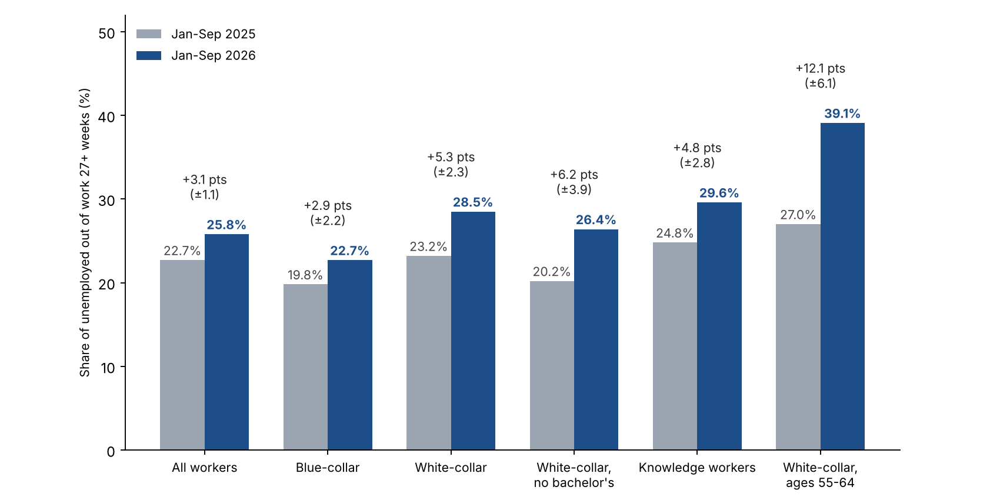

# October 2026 White Collar Employment Report

*Version 1.11. Covers October 2026 data; to be published in November 2026. Not published or sent.*

## Hiring improved in October, but more unemployed white-collar workers are in long spells than a year ago

Employers added 165,000 jobs in October and unemployment edged down to 4.1% (BLS, seasonally adjusted). Yet among unemployed white-collar workers, 28.5% had been unemployed for 27 weeks (about six months) or more in January to September 2026, up from 23.2% in the same months of 2025. The share is highest, and rose most, among workers aged 55 to 64: 39.1%, up from 27.0%. Among knowledge workers (white-collar occupations with a bachelor's degree or more) it is 29.6%, up from 24.8%. All three increases are larger than their 90% margins of error on the year-over-year changes (about ±2.3, ±2.8 and ±6.1 percentage points, estimated by NextChapter with the BLS generalized-variance method, not margins published by BLS), and they also clear an additional, more conservative sensitivity calculation (about ±3.4, ±4.3 and ±8.8).

Two limits on what this shows. First, long spells also became more common for blue-collar workers (+2.9 points) and for all workers (+3.1). White-collar workers' +5.3 is not shown to be larger: the difference from blue-collar is 2.4 points against a margin of about ±3.2, so we do not say white-collar workers are worse off than others. What does clearly differ is the level: 28.5% of unemployed white-collar workers are in long spells against 22.7% for blue-collar workers (difference 5.8 points, margin about ±2.4). Second, at ages 55 to 64 the white-collar rise (+12.1) is not distinguishable from the all-worker rise at those ages (+5.9; difference 6.2 against about ±7.1), though the white-collar level is higher (39.1% against 30.5%; margin about ±5.3).

 The white-collar unemployment rate itself is low, 2.63% against 2.48% a year earlier, so the squeeze shows up in the share of unemployed workers already out 27 weeks or more, not in how many people are out of work. NextChapter's White-Collar Long-Search Index (2019 = 100, seasonally adjusted, three-month average) was 153 in September, down from a peak of about 170 in June but above the 135 of September 2025. The margin on the three-month index is about ±17 points, so the gap with a year ago is within sampling noise and we rely on the nine-month comparison above; a single month is noisier still. Long-term unemployed workers are about 0.75% of the white-collar labor force, up from about 0.58% (the unemployment rate times the long-term share, our calculation).

*A hypothesis, not a finding: slower exits and fewer people entering unemployment.* The unemployment rate barely moved while the share in long spells rose five points. That pattern is what you would see if fewer newly unemployed people were entering the pool and those already in it were leaving slightly more slowly: people who have been out for months then make up a larger share even without a rise in layoffs. We looked by matching the same people in consecutive months of the CPS (January to September, eight month-to-month pairs, about 415,000 matched people in 2026). Among unemployed white-collar workers, 25.3% were employed the next month, against 27.7% a year earlier (-2.4 points, margin about ±4.5), and among those out 27+ weeks, 13.2% against 16.4% (-3.2, margin ±7.3). Among employed white-collar workers, 0.63% were unemployed the next month, against 0.71% (-0.08, ±0.13). The point estimates lean the way the hypothesis predicts, but none of the white-collar changes is distinguishable from zero. Only the all-worker entry rate shows a measurable decline (0.97% to 0.86%, -0.11, ±0.10). The entry measure counts every route from employment into unemployment, including quits, so a flat white-collar entry rate does not rule out more layoffs. Because the public CPS files carry no longitudinal weights, these flows use each month's regular survey weight, so levels are approximate and we compare the two years under the same method. As a check on the entry rate, BLS's published employed-to-unemployed flow (all workers, seasonally adjusted) averaged 1.50 million a month in January to September 2026 against 1.66 million in 2025, down 9.7% (about 0.92% and 1.02% of employed people), close to our matched all-worker rates of 0.86% and 0.97% (down 11%); our rates run about 6% below BLS's. We have not checked the exit flows. Hiring improved in October, which could reverse the pattern; the October CPS file is not out yet.

*Is the rise in long spells a shift toward retirees or voluntary leavers? Not in these data (our CPS calculation).* Among unemployed white-collar workers, the share who lost or finished a job was 59.0% against 59.2% a year earlier, job leavers 12.9% against 11.9% and people re-entering the labor force 28.1% against 28.8%, and the share out 27+ weeks rose within every group (job losers 21.1% to 25.8%, leavers 19.0% to 25.5%, re-entrants 29.2% to 35.7%; differences not tested). At ages 55 to 64, 68.7% were job losers (74.0% a year earlier) and 21.4% re-entrants (15.7%), and the share of unemployed white-collar workers who were out of the labor force the next month was 19.0% against 18.7%, so there is no sign of a surge into retirement; the rise in re-entrants (163 observations in 2026) is worth watching.

*What it means for a job seeker:* Economy-wide openings per unemployed person are up from a year ago (not a white-collar-specific measure), so there is more to apply to. At the same time, long-duration unemployment has become more prevalent among unemployed white-collar workers: the share whose ongoing spell has lasted at least 27 weeks rose from 23.2% to 28.5%. This measures ongoing spells rather than the probability that a newly unemployed worker will remain out six months, but job seekers should still plan for the possibility of a prolonged search.

*Method note:* the CPS measures how long people have been unemployed so far, not whether they are actively searching. Margins of error use the BLS generalized-variance method with BLS's published CPS parameters, as in the September edition; for subgroups we apply the parameters for all unemployed people, which can understate variance for small groups, so we also check each result against a more conservative rule (design effect 2.0, pooled months counted as 40% independent). Both, and the month-to-month matching, are documented in the methodology note. Census October microdata are not yet published, so occupation-level figures run through September, while payrolls and unemployment are October and JOLTS and CPI are September. The October CPS figures and the early-warning section on early-career and senior white-collar unemployment will be added when Census publishes the file (listed for about November 19). As a check, the same pipeline reproduces BLS's published all-worker figures for these months: unemployment rate 4.32% in 2026 and 4.30% in 2025, and share out 27+ weeks of 25.8% against BLS's 25.9% (2026) and 22.7% against 22.6% (2025).

## Who we mean: white-collar, professional, college-educated and knowledge workers

These groups overlap; they are not nested.

- **White-collar:** people whose current or most recent job is in Census occupation group 1 (management, business and financial) or 2 (professional and related). Same definition as September.
- **College-educated:** people with a bachelor's degree or more, in any occupation.
- **Knowledge workers (our working definition):** white-collar occupation and a bachelor's degree or more. There is no official definition; the term is used for workers whose main input is expertise and judgment, and this is a measurable overlap of the other two.

Share of employed people, January to September 2026 monthly average (Census CPS, not seasonally adjusted):

| Group | Employed (thousands) | Share of all employed |
|---|---:|---:|
| All employed | 162,655 | 100% |
| White-collar occupations | 71,389 | 43.9% |
| Bachelor's degree or more, any occupation | 68,539 | 42.1% |
| Knowledge workers (both) | 49,913 | 30.7% |
| White-collar without a bachelor's degree | 21,476 | 13.2% |
| Blue-collar occupations (Census groups 7 to 10) | 32,853 | 20.2% |

Knowledge workers are about 70% of employed white-collar workers and about 73% of employed college graduates.

| Group, January to September | Unemployment rate, 2026 | Unemployment rate, 2025 | Share out 27+ weeks, 2026 | Share out 27+ weeks, 2025 | Median weeks in current spell, 2026 | Median weeks in current spell, 2025 |
|---|---:|---:|---:|---:|---:|---:|
| All workers | 4.32% | 4.30% | 25.8% | 22.7% | 11 | 9 |
| White-collar | 2.63% | 2.48% | 28.5% | 23.2% | 12 | 9 |
| Bachelor's or more (any occupation) | 3.01% | 2.86% | 29.3% | 26.0% | 12 | 12 |
| Knowledge workers | 2.54% | 2.32% | 29.6% | 24.8% | 13 | 10 |
| White-collar without a bachelor's | 2.85% | 2.85% | 26.4% | 20.2% | 11 | 8 |
| Blue-collar | 4.95% | 5.04% | 22.7% | 19.8% | 9 | 8 |

Note: Unweighted unemployed person-month observations (January to September pooled; the same person can appear in more than one month), 2026 / 2025: all workers 15,822 / 16,915; white-collar 4,315 / 4,417; knowledge workers 2,861 / 2,856; white-collar without a bachelor's 1,454 / 1,561; bachelor's or more 4,614 / 4,662; blue-collar 3,765 / 4,023; white-collar ages 55 to 64 768 / 763.

White-collar workers aged 50 and over: 37.0% out 27+ weeks vs 29.5%, median spell so far 16 weeks vs 12. Ages 55 to 64: 39.1% vs 27.0%, median spell so far 18 weeks vs 12 (768 unemployed person-month observations in 2026). White-collar workers without a bachelor's degree show the same year-over-year rise with no change in unemployment: their unemployment rate was 2.85% in both years, while the share out 27+ weeks rose 6.2 points, from 20.2% to 26.4% (±3.9 points by the BLS method and ±5.7 by the conservative rule; it clears both). The rise for knowledge workers was 4.8 points; the difference between the two groups' increases is within the margin of error, so we do not say one group is worse off. We make no claim about the 0.15-point rise in the white-collar unemployment rate; it is small and we have not tested it. Not seasonally adjusted; October CPS is not published yet.

## Why white-collar and professional work matters for the middle class

White-collar occupations are a larger part of the workforce than blue-collar ones (43.9% against 20.2% of employed people), and white-collar job losses are often less concentrated in a single employer or location (our reading).

- **Losses can be long-lasting.** Lachowska, Mas and Woodbury (2020), using Washington State records, find earnings about 16% below those of comparable workers five years after a job loss. Davis and von Wachter (2011) find that over 20 years the loss averages 1.4 years of prior earnings when a layoff happens while unemployment is under 6%, and 2.8 years when it is above 8%. Schwerdt, Ichino, Ruf, Winter-Ebmer and Zweimüller (IZA, 2008) find that the long-run effects of Austrian plant closures are weak for blue-collar workers but strong and persistent for white-collar workers. These are studies of past periods and specific groups.
- **Many do recover.** The BLS survey of workers who lost jobs found that 66.1% of long-tenured workers who lost jobs in 2023 to 2025 were working again by January 2026, and about half of those earned as much as before (BLS, August 2026). The cost is in time and, for many, pay.
- **The middle class leans on this work.** Pew Research Center (2022) found the share of adults in middle-class households fell from 61% in 1971 to 50% in 2021, and that 39% of adults with at least a bachelor's degree were in the upper-income tier in 2021, against 16% or less of those without a degree. A job lost by a household's main earner affects income, employer health coverage and the ability to carry a mortgage at once, and a longer spell lengthens each.

*What it means for a job seeker:* plan for a possibly long search, including savings, health coverage and a wider set of target employers and metros from day one.

## Industry, age, shifts, new graduates and place

The table sets white-collar workers (Census occupation groups 1 and 2) beside all workers, by the industry of the job they last held and by age. Rows are January to September 2026 against the same months of 2025, not seasonally adjusted. The margin is the 90% margin of error on the change in the share out 27+ weeks (BLS generalized-variance method, as for Exhibit 1); a change larger than its margin is marked with an asterisk; the starred cells are exploratory and not adjusted for multiple comparisons. Cells with fewer than 100 unemployed person-month observations in either year are not shown.

| Group | White-collar: unemployment rate, 2026 (2025) | White-collar: share out 27+ weeks, 2026 (2025) | White-collar: change, points (±margin) | All workers: unemployment rate, 2026 (2025) | All workers: change in share out 27+ weeks, points (±margin) |
|---|---:|---:|---:|---:|---:|
| Everyone | 2.63% (2.48%) | 28.5% (23.2%) | +5.3 (±2.3)* | 4.32% (4.30%) | +3.1 (±1.1)* |
| **Industry of last job** | | | | | |
| Information | 5.17% (4.64%) | 38.3% (25.2%) | +13.1 (±10.2)* | 5.25% (5.06%) | +5.9 (±8.2) |
| Financial activities | 2.21% (1.99%) | 31.8% (33.1%) | -1.3 (±8.7) | 2.36% (2.36%) | -1.0 (±6.1) |
| Professional and business services | 3.23% (2.91%) | 31.3% (25.3%) | +6.0 (±4.8)* | 4.08% (4.01%) | +3.1 (±3.3) |
| Education and health | 2.50% (2.29%) | 23.3% (19.2%) | +4.1 (±3.7)* | 3.18% (2.89%) | +2.9 (±2.7)* |
| Public administration | 1.70% (1.58%) | 28.4% (19.2%) | +9.2 (±12.2) | 1.99% (1.75%) | +7.9 (±8.0) |
| **Age** | | | | | |
| Under 35 | 3.28% (3.05%) | 21.1% (17.3%) | +3.8 (±3.4)* | not shown | not shown |
| 35 to 44 | 2.09% (2.05%) | 27.8% (23.9%) | +3.9 (±5.0) | 3.28% (3.32%) | +2.1 (±2.8) |
| 45 to 54 | 2.32% (2.10%) | 32.5% (25.9%) | +6.6 (±5.4)* | 3.18% (2.99%) | +2.9 (±3.2) |
| 55 to 64 | 2.60% (2.47%) | 39.1% (27.0%) | +12.1 (±6.1)* | 2.94% (2.91%) | +5.9 (±3.6)* |

Note: unemployed person-month observations behind each white-collar row, 2026: everyone 4,315; information 237; financial activities 310; professional and business services 947; education and health 1,505; public administration 178; under 35 1,378; 35 to 44 900; 45 to 54 832; 55 to 64 768. Industry is the industry of the last job, and "white-collar" is the occupation of that job. Census CPS basic monthly microdata, NextChapter calculation. All-workers figures for under 35 are not shown because that age band is built from different groups elsewhere in our data.

- **White-collar unemployment is lower than the all-worker rate in every row.** In information the two are nearly equal (5.17% and 5.25%). We did not test whether the gaps in the rates are larger than sampling error, and we make no claim about them.
- **We do not show that white-collar spells lengthened more than all workers' spells.** In education and health, white-collar +4.1 points against all workers +2.9; at ages 55 to 64, +12.1 against +5.9. The differences between the two are within their margins (at ages 55 to 64, 6.2 points against about ±7.1). What is clear at ages 55 to 64 is the level: 39.1% of unemployed white-collar workers are in long spells against 30.5% of all unemployed workers that age.
- **Financial activities is the exception.** The share out 27+ weeks was flat to slightly lower for white-collar workers, even though payroll employment in the sector is down 1.1% over the year (BLS); the CPS measures those who report the sector as their last job, not payroll jobs, and the two are not the same.
- **Read the many-cell table with care.** Nineteen changes are tested at the 90% level, so about 1.9 would clear by chance alone if nothing had changed. The cells overlap (the age and industry rows describe the same people), so they are not nineteen independent pieces of evidence; the direction is descriptively consistent across most rows, but we do not claim a combined test.

*What it means for a job seeker:* the longer spells show up across industries and ages, most clearly at ages 55 to 64 and in information and professional services, while finance looks different. A search plan should rest on your own field and age group, not on the average.

### Winners, losers and shifts

A modest net gain hides large moves between sectors, occupations and places. These are descriptions of where jobs and job ads moved; they do not show that AI or any single cause explains them.

- **By industry (BLS payrolls, October 2025 to October 2026, seasonally adjusted, preliminary).** Total payrolls rose 0.6%. Health care and social assistance added 519,000 (+2.2%), construction 124,000 (+1.5%), manufacturing 78,000 (+0.6%), retail 63,000 (+0.4%) and leisure and hospitality 16,000 (+0.1%); professional and business services has added 269,000 since a low in October 2025. Information fell 119,000 (-4.2%), financial activities 99,000 (-1.1%) and federal government 71,000 (-2.6%). The net gain is concentrated: health care alone is larger than the gains in construction, manufacturing, retail and hospitality combined.
- **By occupation (CPS, January to September 2026 against 2025, not tested; group employment is noisy).** Employment was higher in community and social service (+3.0%), life, physical and social science (+2.5%), transportation (+2.2%), healthcare practitioners (+2.1%), architecture and engineering (+1.7%) and computer and mathematical (+1.5%), and lower in construction (-5.9%), protective service (-5.0%), legal (-3.6%), installation and repair (-2.9%), healthcare support (-2.4%) and arts, design and media (-2.3%). The household and payroll surveys disagree on construction (the household survey's occupation count fell while BLS payrolls for the industry rose 1.5%), a reminder that occupation and industry differ and that each survey has error.
- **By job ads (Indeed Hiring Lab, seasonally adjusted, October 30; February 2020 = 100).** Over the year, postings rose most in mechanical engineering (+44.8%), industrial engineering (+40.5%), electrical engineering (+34.6%), software development (+23.8%), scientific research and development (+21.5%), project management (+16.0%), human resources (+15.2%) and banking and finance (+12.1%), and fell most in dental (-12.8%), childcare (-9.8%), education and instruction (-8.9%), social science (-7.1%) and accounting (-4.3%). Against February 2020 the picture differs: data and analytics (-38%), media and communications (-33%), marketing (-23%), IT systems and solutions (-23%) and software development (-18%) remain well below, while physicians and surgeons (+96%), therapy (+91%), civil engineering (+61%), personal care and home health (+61%), electrical engineering (+55%) and construction (+29%) are well above.
- **Postings by how exposed the work is to AI (our grouping, an association).** We sorted 34 of Indeed's 47 sectors by the Anthropic Economic Index score of the occupations they contain: 15 more-exposed sectors (software, data, IT, legal, administrative, customer service, accounting, banking and finance, human resources, insurance, marketing, media, arts, sales) and 19 less-exposed ones (health care, personal care, construction, installation, driving, cleaning, food service, production, loading, childcare, engineering fields, architecture). The sector grouping is ours and involves judgment; the sector table is in the data download. Postings in the more-exposed group are up a median 4.5% over the year, against 5.1% for the less-exposed group, a similar rebound. Against February 2020, the more-exposed sectors are a median 13% below and the less-exposed sectors 25% above. That gap predates generative AI adoption at scale (the baseline includes the pandemic hiring boom and rate increases), so it cannot be attributed to AI; the job-ad indexes of the more-exposed sectors have not recovered to their February 2020 level, while those of the less-exposed sectors are above it.
- **What the shifts add up to (our reading).** The net gain comes mainly from health care and professional services; information, finance and federal employment are the losers; the AI-exposure comparison shows similar employment changes in more- and less-exposed occupations over the past year, a long-run shortfall in job ads for the more-exposed sectors against 2020, and the largest rise in long spells in computer and mathematical occupations. Those pieces fit a market where demand has moved, not collapsed. Whether people leaving shrinking sectors find the move slower is a hypothesis we cannot test with these data, and none of this identifies AI as the cause.

### Early-career workers and new graduates

- **Our data do not test the early-career story, and the older-age finding does not contradict it.** Press coverage of AI and jobs focuses on young workers. Our measure is the share of already-unemployed people in long spells, so it cannot see young people who are never hired into a first job, who stay in school or who leave the labor force; the research on early-career workers is about hiring and employment, not spell length. In our data the longest spells and the largest rises are at older ages, and white-collar workers under 35 have the shortest (21.1%, up from 17.3%; +3.8, margin ±3.4). Both can be true.
- **Recent graduates (ages 22 to 27 with a bachelor's degree or more, any occupation; not a white-collar-only figure; our CPS calculation).** Unemployment 5.44% in January to September 2026 and in 2025, against 4.32% for all workers; 25.5% of the unemployed out 27+ weeks, up from 21.9% (+3.6; margin ±4.7 by the BLS method and ±7.8 by the conservative rule, so not distinguishable from no change). The unemployment rate for all workers aged 16 to 24 was 9.36%, against 10.07% (not tested). Based on 766 unemployed person-month observations in 2026.
- **New York Fed (2026 Q3).** The unemployment rate for recent college graduates was 5.2%, which the Fed describes as a fall, and the underemployment rate (working in a job that does not typically need a degree) 42.5%, which it describes as ticking up. Press coverage reports a separate New York Fed study attributing much of the rise since 2019 to remote work; we have not read it.
- **Employer surveys and postings point different ways, as reported.** NACE's spring 2026 update projects employers will raise hiring of the class of 2026 by 5.6%, up from a 1.6% projection in November 2025; Handshake's August data show full-time postings down more than 16% from a year earlier and applications per job up 26% (secondary reports; we have not read the originals). Stanford's August update (above) finds employment of 22- to 25-year-olds in the most AI-exposed occupations 19% below comparable peers; the authors treat that as an early indicator, not proof of cause.
- **What open jobs show.** 130,710 of the 487,679 verified open jobs we track (27%) are entry-level or early-career (Employers chapter). We have no earlier counts to compare.

### Higher education: new graduates, older alumni and what colleges provide

- **New and older degree-holders face different problems (our CPS calculation; bachelor's degree or more, any occupation, January to September 2026).** Unemployment: 5.44% at ages 22 to 27, 2.80% at 28 to 34, 2.36% at 35 to 44, 2.56% at 45 to 54, 2.95% at 55 to 64. Share of the unemployed out 27+ weeks: 25.5%, 26.1%, 27.1%, 34.2% and 37.0%. Recent graduates are the most likely to be unemployed but the least likely to be in a long spell; the oldest degree-holders are the least likely to be unemployed and the most likely to be in a long spell, and 55 to 64 is the only band whose long-spell rise (+9.3 points) clears a conservative margin (about ±8.7). The other bands are within their margins. In our reading, new graduates' problem is getting in and older alumni's is getting back in.
- **The degree still goes with lower unemployment, with one exception.** Unemployment for people without a bachelor's degree was 7.06%, 5.51%, 4.14%, 3.71% and 2.94% in the same bands. At 55 to 64 the two rates are about equal (2.95% and 2.94%) and long spells are more common among degree-holders (37.0% against 25.9%). We did not test the differences between rates, and these are associations, not the effect of a degree.
- **Employers' view (as reported).** 70% of employers use skills-based hiring, up from 65%, and NACE's spring update projects 5.6% more hiring of the class of 2026 (NACE); only 37% of employers think higher education prepares students with the skills they need (WGU and Centiment, 2026).
- **What colleges are offering alumni (announcements, not outcomes).** Examples: Saint Leo University's lifelong learning commitment for more than 107,000 graduates, free Google AI and career certificates for alumni at New York University and the University of Michigan, and career services open to graduates in their 40s and 50s at more than 40% of universities in England and Wales (reported). Many offers are time-limited or limited to certain schools, and a career-services trade session notes that colleges struggle to support alumni at scale.
- **What we could not find.** Outcome data (placement, pay or time to re-employment) for any alumni retraining or alumni career service; 2026 career-center staffing and budget figures (NACE's 2026 benchmarks survey is in the field and not published); and any measure of how many older alumni use these services. Our reading, not a finding: most of what colleges announce for older alumni is free courses and certificates rather than job-search help with measured results, while the support that is built to scale is for current students and recent graduates.

### Is the degree still worth it? Where the doubts are right and where they are not

The case that higher education's value is breaking is that a degree is expensive and new graduates cannot find degree-level jobs. The data say that is true for some people, majors and prices, and not for others.

- **Right at the entry point.** Recent graduates are more likely to be unemployed than all workers (5.44% against 4.32%, our CPS calculation, above), and the New York Fed puts their 2026 Q3 underemployment (working in a job that does not typically need a degree) at 42.5%.
- **Right for some majors (New York Fed table for recent graduates, Census data for 2024; we could not read the table at the source, so these are as reported).** Unemployment was highest for anthropology (7.9%), computer engineering (7.8%) and computer science (7.0%) and lowest for special education (0.7%), elementary education (1.2%) and nursing (2.1%). Underemployment was highest in criminal justice (65.8%), performing arts (63.9%) and fine arts (58.9%) and lowest, below 20%, in computer science and computer engineering. Computer majors face a hard first search but, once hired, work in degree-level jobs; arts and criminal-justice majors often find work that does not use the degree.
- **Not right mid-career.** Degree-holders had lower observed unemployment rates than people without a bachelor's degree through age 54 (2.80% against 5.51% at 28 to 34; 2.36% against 4.14% at 35 to 44; rates not tested), and the College Board reports median full-time earnings of about $81,800 for bachelor's holders against $50,600 for high school graduates (via secondary coverage). At 55 to 64 the unemployment rates are equal (see above).
- **Return and price.** The New York Fed estimates the median graduate's return to a four-year degree at 12.5% a year (2024 data), counting about $30,000 of net price over four years (room and board excluded) and about $150,000 of earnings given up, $180,000 in all. It is a median for graduates and assumes four years; it does not show dropouts or slower completion, which lower the return. "Too expensive" is most true at the published price of private colleges (about $45,000 a year) and least true for in-state public students after aid (published tuition and fees about $11,950; net about $2,300; College Board via one article).
- **Highest and lowest return, as reported.** The New York Fed's work on returns by major (as reported by secondary coverage) finds higher returns in engineering, mathematics and computing, business and economics, and health sciences, and lower returns in fine arts, liberal arts, leisure and hospitality, and education (very low unemployment but lower pay). Research from the Foundation for Research on Equal Opportunity estimates returns for nearly 30,000 bachelor's programs and concludes that the school and major matter more than whether to attend; we have not read its program rankings.
- **Confidence and AI.** Gallup and Lumina's survey of public confidence finds 38% to 42% of adults have a great deal or quite a lot of confidence in higher education, against 57% about a decade ago, and a plurality expect AI to lower the value of a degree (reported). Computer science enrollment fell 12.4% at four-year colleges and 10.4% in graduate programs this fall (National Student Clearinghouse preliminary report, October 29, reported), while computer and mathematical occupations have the highest observed AI exposure and the sharpest rise in long spells, and software job ads are 18% below February 2020. These trends coincide; the data do not tell us why students changed what they study, and do not show that AI caused it.

### Where jobs are growing and shrinking

Three views, each with limits: BLS state payrolls (all industries, not white-collar), Indeed's metro postings index, and our CPS estimates for white-collar workers by Census division. We have no reliable state-level white-collar payroll measure.

- **BLS state payrolls, September 2026.** Over the month, gains in New Jersey (+14,900) and South Carolina (+12,500), a decline in Wisconsin (-13,700) and little change elsewhere. Over the year, the largest gains were Texas (+154,300), California (+129,300) and North Carolina (+67,000), and the District of Columbia had the only significant loss (-25,800, -3.5%) and the highest unemployment rate (5.6%) (BLS, October 20 release). The October state release is due November 20.
- **Metro job ads (Indeed, October 30; February 2020 = 100).** Houston, Austin, Nashville, Dallas-Fort Worth and Charlotte are 13% to 17% above the February 2020 level; Seattle (67), San Francisco (72), Boston (84), New York and Los Angeles (86) are well below. Among 30 large metros we checked, San Francisco (+15.5%) and Austin (+15.4%) gained most over the year, and only Orlando, Philadelphia and New York were below a year earlier; the median of 592 metros is +1.4%. The pattern fits a rebound in the software-heavy Bay Area and Austin from low levels, alongside long-run strength in Texas and the Southeast.
- **White-collar workers by Census division (our CPS calculation, January to September 2026 against 2025, not seasonally adjusted).** Estimated white-collar employment was higher in the Southern divisions (+1.9% to +3.2%) and the West North Central (+3.0%) and lower in New England (-4.0%), the Mountain states (-3.5%) and the Pacific (-1.8%). None of these employment changes is tested, and state samples are small. The share of unemployed white-collar workers out 27+ weeks rose in every division, but none is distinguishable from no change by a conservative rule (margins about ±8 to ±15 points). The one clear exception is the District of Columbia: +23.7 points (39.9% against 16.2%, margin ±16.3), consistent with its payroll loss; federal government employment is down 71,000 nationally over the year.
- **Where our own open jobs are (November 7; all functions and levels, a snapshot).** Among the 20 states with the most open jobs, the share naming an AI skill is highest in Washington (18.8%), California (17.8%) and New York (15.4%) and lowest in Ohio, Florida and Pennsylvania (4% to 5%). Median posted pay is $175,000 in California against about $103,000 in Florida; states with pay-range laws have more postings with pay, so pay is not comparable across states without that adjustment.

## Bright spots

Reference periods differ by row: payrolls and unemployment are October, JOLTS is September, Challenger is October announcements (not seasonally adjusted). Seasonally adjusted unless noted.

| Measure | Latest | Comparison | Source |
|---|---|---|---|
| Payrolls, October (seasonally adjusted) | +165,000 (+0.1% m/m; +0.6% y/y) | about 65,000 expected; August revised to +186,000 and September to +60,000 | BLS |
| Unemployment rate, October | 4.1% | 4.2% in September | BLS |
| Job openings, September (economy-wide) | 7.52 million, up 333,000 from August | August revised to 7.19 million; BLS describes the level as little changed | BLS JOLTS |
| Openings per unemployed person, September (economy-wide) | 1.06 | 1.02 in August; 0.94 a year earlier | BLS (our calculation) |
| Layoff rate, September (economy-wide) | 1.0% | 1.1% in August; BLS describes the change as small | BLS JOLTS |
| Quits rate, September (economy-wide) | 2.1% | 1.9% in August; BLS shows 197,000 of the roughly 321,000 rise was in accommodation and food services; quits elsewhere still rose 124,000 | BLS JOLTS |
| Professional and business services, October | +70,000 (+0.3% m/m; +1.2% y/y); +269,000 since a low in October 2025 | professional, scientific and technical +33,000 (computer systems design +3,200); administrative and support services +28,000; management of companies and enterprises +9,000 | BLS |
| Announced layoffs, October (not seasonally adjusted) | 43,994 | down 71% from October 2025; lowest October since 2023 (36,836) | Challenger |
| Indeed Job Postings Index, Oct 16 (Feb 2020 = 100, seasonally adjusted) | 103.8 (+2.8% y/y) | new postings flat over the month (99.2); the sector and metro series used later in this report are daily and run to October 30 | Indeed Hiring Lab |

Payroll gains over January to October 2026 total 861,000 on current revisions (BLS). September had looked "soft, but not dire" (Employ America) and "steadiness without a spark" (Indeed); October beat expectations, though announced hiring plans are mostly seasonal (72% of 2026 plans, Challenger).

*What it means for a job seeker:* Demand is broader than a month ago (68% of occupational sectors are above year-ago postings, Indeed), but new postings are flat over the month, so the flow of fresh listings has not picked up.

## Clouds

Reference periods differ by row: wages and sector payrolls are October, prices and JOLTS are September, ECI is Q3 (twelve months to September), and Challenger is January to October. Seasonally adjusted unless noted.

| Measure | Latest | Comparison | Source |
|---|---|---|---|
| Wages vs prices | wages +3.1% y/y (October); consumer prices +3.7% y/y (September, not seasonally adjusted) | different months; prices +0.6% in September | BLS |
| Information employment, over the year (seasonally adjusted) | -4.2% (-119,000); October -1,000 (little changed) | total payrolls +0.6%; data processing, web hosting and related services 0 in October | BLS |
| Financial activities employment, over the year (seasonally adjusted) | -1.1% (-99,000) | | BLS |
| Hires rate, September | 3.4% | 3.3% in August | BLS JOLTS |
| Announced hiring plans (Challenger, 2026) | 72% seasonal | concentrated in five companies | Challenger |
| Technology announced cuts, January to October | 171,501 | up 21% from 141,159 in the same months of 2025 | Challenger |
| Employer health-benefit costs vs wages, twelve months to Q3 | health benefits +6.4%; wages +3.1% | KFF 2026: single-coverage premium +5% to $9,804; family worker contribution +9% to $7,471 | BLS Employment Cost Index (via Employ America); KFF |

Seattle, San Francisco and Santa Rosa have among the lowest local postings indexes in the country (Indeed).

*What happened to tech.* Announced technology cuts are large, 171,501 from January to October, up 21% (Challenger). The data show a narrower picture:

- **Payrolls.** Information employment is down 4.2% (119,000) over the year, but only 1,000 in October. Most of the decline is not software: telecommunications is down about 35,000 (-5.9%), computing infrastructure, data processing and web hosting about 26,000 (-5.4%), motion picture and sound recording about 20,000 (-5.6%) and software publishers about 8,000 (-1.1%, through September), together roughly three-quarters of the 119,000 (BLS data pages; the months differ slightly). Professional, scientific and technical services added 33,000 in October (computer systems design +3,200, to 2.35 million).
- **Occupations (household survey).** Employment in computer and mathematical occupations, the closest group to software work that the public data separate, averaged 6.83 million in January to September 2026, 1.5% above a year earlier (not tested; the estimate is noisy). Its unemployment rate was 3.31% against 3.22%, but the share of its unemployed out 27+ weeks was 41.9% against 27.2%: +14.7 points, margin about ±7.2 (±10.9 by the conservative rule), the largest rise of any occupation group with at least 400 unemployed observations (517 in 2026). So employment in these occupations is estimated to be higher, while the long-spell share among their unemployed workers has risen; these are different groups of people, and the data do not follow individuals from one to the other.
- **Job ads.** Indeed's software development postings index (February 2020 = 100) was 81.6 on October 30, up 23.8% from 65.9 a year earlier but still 18% below February 2020 and far below its early-2022 level of about 225 (seasonally adjusted).
- **Our open jobs (November 7; engineering titles for software, web, mobile, machine learning, data and DevOps, identified by title).** 29,605 postings from 6,010 employers (5.5% of the total): 32.2% name an AI skill (against 10.6% of all jobs), 27.4% are entry-level or early-career and 51.8% are senior or above; median posted pay is $192,500 (7,951 postings with a range) and 24% are in California. A snapshot with no trend, from employers that are not a random sample.
- **What we cannot isolate.** Software engineers: the public file groups them with mathematical occupations, and Challenger classifies cuts by the employer's industry, not the occupation cut, so we cannot say how many of the 171,501 were software roles. Our layoff tracker records no occupation and its coverage widened during 2026, so a year-over-year comparison from it would reflect coverage, not layoffs; we do not publish layoffs by occupation.

*Rates:* before the report, Employ America's base case was a Federal Reserve rate increase in December and another in March. A strong report can raise those odds, and higher borrowing costs tend to slow hiring over time. That is one forecaster's view, not a certainty. Sectors that depend on borrowing tend to feel higher rates first: construction, finance, and technology and data center projects funded with debt.

*Watch: data center moratoriums.* Several states and localities have proposed or enacted pauses on new data centers; one tracker counted 75 projects blocked or delayed in the first quarter of 2026 and statewide proposals in 14 states (Rockefeller Institute, citing Data Center Watch; trade-source figures, not independently checked). The direct effect is on temporary construction and electrical work, which is mostly blue-collar. A white-collar effect is possible but unmeasured: engineers, architects and project managers do design and management work ahead of construction. We make no estimate here and will track open postings for those roles in later editions.

*What it means for a job seeker:* The pressure is in information, finance and technology roles. The latest available readings show nominal wage growth of 3.1% in October and consumer-price inflation of 3.7% in September; these are different reference periods, not a direct real-wage comparison. Look at sectors adding jobs (professional services, health care) alongside the one you know.

## Layoffs and voluntary exits

- **Microsoft:** voluntary exit offers to about 60,000 employees, announced Oct 26. The 60,000 is the number eligible, about a quarter of the workforce, up to level 70 in the U.S., Canada, the U.K. and India, in participating organizations only. Microsoft reportedly anticipates under 5% will accept. The 60,000 and the eligibility details are as reported by CNBC, GeekWire, Fortune and Windows Central, not an official figure we could read. Challenger records voluntary programs by actual acceptances or a stated target, so these offers are not in its October total, and says such offers “tend to signal more layoffs to come”.
- **Google:** confirmed to Reuters on Nov 4 that it expanded voluntary exit offers in June 2026 to employees in Canada, France, Germany, Japan and Switzerland, following U.S. rounds that began in 2025. Participation has not been disclosed, and some units (Cloud, DeepMind) have been excluded.
- **Squarespace:** about 300 employees, 19% of staff, confirmed by the company (TechCrunch, Nov 2).
- **Amazon:** fewer than 1,000 corporate roles, mainly in its Stores division, confirmed Oct 7 (Reuters).
- **Disney:** a WARN filing for 159 theme-park workers in October.
- **Challenger on reasons:** AI was the stated reason for about 20% of announced cuts in 2026 (121,401 of 617,189) but only 1,265 in October, the lowest month of 2026; market and economic conditions are now the top reason. This is what employers say, not a finding that AI caused outcomes.

The full list of announcements we track is in NextChapter's layoff tracker; items there are reported by news outlets and not all are confirmed, so this section lists only company-confirmed announcements and filings.

*What it means for a job seeker:* a voluntary exit offer is a signal of restructuring, not a layoff, and the people who take them re-enter the market, often with a package that funds a longer search.

## Employers: who is hiring

Counts as of October 26, 2026, not seasonally adjusted, from NextChapter's daily count of verified open jobs on employer career sites and the job systems behind them (a job counts as verified when our crawl has confirmed it is still live on the employer's career site or job system within the past 14 days): 487,679 jobs, of which 130,710 (27%) are entry-level or early-career. This is a different universe from the Anthropic section below, which uses open postings in our crawl as of November 6 (653,974, excluding postings that link through a job aggregator), including imported postings not yet verified, some of which may no longer be open. These are all functions and levels, entry-level included; the Census white-collar test is not applied, so the counts are never combined with the white-collar figures above. A ranking shows who has the most open jobs among the jobs we track, not who hires most in the economy and not how good an employer is. Coverage is partial and follows our sources.

**Most entry-level jobs (roughly 0 to 3 years of experience)**

| # | Employer | Entry-level | Open |
|---:|---|---:|---:|
| 1 | Amazon | 2,140 | 9,460 |
| 2 | SpaceX | 1,124 | 2,211 |
| 3 | Cintas | 615 | 714 |
| 4 | Albertsons Companies | 496 | 588 |
| 5 | Anduril Industries | 474 | 1,913 |
| 6 | CACI International | 434 | 1,777 |
| 7 | Lockheed Martin | 429 | 1,385 |
| 8 | JPMorgan Chase | 428 | 2,891 |
| 9 | RTX | 428 | 1,539 |

Safeway, an Albertsons brand, is listed separately by the source at 458 entry-level of 546 open.

**Most jobs that need no experience (the posting says so):** Rollins 171; Unifirst 116; AT&T 98; Dewberry 78; Langan 59; SpaceX 42; Kiewit Infrastructure West 27; Bechtel Energy 26; AML RightSource 24; AIL 22.

**Employers asking for AI skills** (the posting names a specific AI skill or tool; this describes what postings ask for, not what caused any hiring or cut)

| Employer | Jobs asking for AI skills | Share of its open jobs |
|---|---:|---:|
| Amazon | 2,487 | 26% |
| Nvidia | 407 | 50% |
| Salesforce | 346 | 54% |
| Anthropic | 343 | 61% |
| Intuit | 341 | 50% |
| Capital One | 326 | 25% |
| Crusoe | 325 | 96% |
| OpenAI | 303 | 45% |
| Accenture | 292 | 45% |
| Google | 280 | 14% |

Method: staffing and search firms are excluded; employers are matched by name and duplicate entries for one company are counted once; one employer whose thousands of postings could not yet be confirmed as distinct jobs is left out until checked. Our employer-level history starts in October 2026, so no month-over-month or year-over-year claim is made for any employer, and no employer is shown here in connection with layoffs. The full top-15 tables for all 21 functions are in the data download.

*What it means for a job seeker:* the employers with the most open jobs are a starting list of where volume is, not a measure of fit; use the function tables to find who hires for your role.

## AI and the workforce: what companies say, what jobs ask for, what the rules and programs are

This chapter covers four things: what companies say about AI and their workforce, what open jobs ask for and pay, what public rules and training programs exist, and (from the Anthropic Economic Index) how much of the work in open jobs AI is observed doing. It describes what is said and posted; it does not show that AI caused any hiring or layoff.

### What companies say about AI and their workforce

Employers cited AI as the reason for 121,401 of 617,189 announced job cuts in 2026 through October, about 20% (Challenger), and only 1,265 in October. Formal filings cite it less often: in our September edition we read every 2026 SEC Form 8-K that references Item 2.05, the item public companies use to report material restructuring costs, filed January 1 to September 30. Of 170 filings, 16 (9.4%, from 14 companies) cited AI as a reason or context in the restructuring section itself, and 24 (14%) mentioned AI, automation or machine learning anywhere. We have not repeated that search for October. The units differ (workers in announced cuts against filings), and a filing silent about AI does not show AI played no role, since Item 2.05 requires the decision and expected costs, not the reasons. Neither source is wrong; the gap between them is worth tracking. New York's layoff-notice system has asked employers since March 2025 whether automation contributed; in its first year none of more than 160 filers said yes (Hunton Andrews Kurth, May 2026), and whether that reflects reality or under-reporting is unknown. Section "Layoffs and voluntary exits" above lists the specific October announcements.

### What open jobs ask for, and what they pay

From the open jobs on employer career sites and job systems that NextChapter tracks (deduplicated, staffing and search firms and internships excluded; November 7, 2026), 56,049 of 531,183 (10.6%) name a specific AI skill or tool in the posting text (the same measure as the employer table above). Of the 110,319 that post a pay range, 16,142 (14.6%) name an AI skill.

Two comparisons, with their limits up front: the same-employer comparison covers only 14% of AI-naming postings with pay (employers that post both kinds in the same cell), employer size and location are not held fixed, and there are no standard errors. Across employers, postings that name an AI skill post higher pay than other postings of the same function and level: in 88 of the 89 function-and-level cells with at least 30 postings of each kind, with a median difference of 22.1% (range -0.5% to +71.9%). **Most of that gap is which employers ask, not what the same employer pays.** Comparing postings within the same employer, function and level (306 cells at 144 employers, each with at least three postings of each kind), the median difference is +0.9% (middle half of cells from -2.6% to +12%); weighted by the number of AI-naming postings it is +3.9%. The AI-naming postings paid more in 159 cells, less in 89 and the same in 58. Employers mostly post one pay band for a role and level whether or not the posting names AI. So these data do not show that naming AI skills raises posted pay at a given employer; they show that the employers who ask for AI skills, such as large technology and finance firms, post higher pay. The within-employer comparison covers 2,281 of the 16,142 AI-naming postings with pay (14%), those from employers posting both kinds in the same cell, so it may not represent all employers.

**Direct check: postings that do not name AI skills at AI-asking employers.** To see whether the premium follows the skill or the employer, we compared postings that do not name AI skills at employers that often ask for them (2,292 employers with at least five AI-naming postings) with postings at all other employers, in the same function and level. The first group pays a median 24.3% more (113 cells with at least 30 postings of each kind; higher in 110 of them; middle half of cells +17% to +31%), about the same premium as for AI-naming postings. These employers are 4% of the 57,648 employers with open jobs, but they hold 42.5% of open jobs and 82.4% of AI-naming jobs, and 84% of AI-naming postings with pay. So the observed premium is mainly associated with which employers post the jobs, not with whether an individual posting names AI skills: jobs at employers that ask for AI skills pay more whether or not they name AI. Limits: employers with five or more AI-naming postings are also large employers, and we did not hold employer size, location or the specific job fixed; the within-employer comparison has no standard errors (we report the spread of cells); and none of this shows whether a worker without AI skills would be considered for those employers' jobs, or that AI skills have no pay value.

**Outside the technology industry.** Of 559,278 open jobs from employers we can identify (a separate run on November 8; the board changes daily, so counts differ slightly from the November 7 run above), 58,659 (10.5%) name an AI skill. Employers our company records classify as Technology & Software have 65,026 of those jobs, 29.7% of which name an AI skill, and hold 33% of all AI-naming jobs. The other 67% (39,350 jobs, 8.0% of those employers' 494,252 jobs) are at employers outside that group, including 9,078 at employers with no industry label, some of which may be technology companies. So named AI-skill demand is not only a technology-company ask. It is, however, concentrated in a few places:

- **By industry (share of jobs naming an AI skill):** advertising, marketing and PR 19.7%; media and entertainment 17.9%; professional services and consulting 16.9%; legal services 15.7%; financial services and banking 14.7%; retail and e-commerce 14.4% (most of it Amazon's 2,487 AI-naming jobs, if Amazon is classified there); automotive 14.1%; accounting 12.0%; telecommunications 11.7%; insurance 11.5%. Lowest: construction and real estate 2.9%, staffing 2.9%, government 3.6%, non-profit 4.1%, health care 5.1%, education 5.1%, manufacturing 5.5%.
- **By function, outside Technology & Software employers:** data and analytics 38.1%, product 25.4%, security 15.7%, engineering 9.5%, marketing 8.9%; but human resources 5.2%, finance 4.7%, legal 4.1%, sales 3.9%, operations 2.5%. Business functions mostly do not yet name AI skills in postings.
- **By employer:** of 60,125 employers outside Technology & Software, 7,096 (11.8%) have at least one AI-naming job and 1,643 (2.7%) have five or more. The ten largest account for 13% of those employers' AI-naming jobs and the fifty largest for 26%, so outside technology it is a broad but thin spread, not a handful of firms.

Our reading: the postings point to specialists wanted in data, product, security and engineering roles across many industries, and not yet to AI skills as a general requirement for business roles. This is a count of specific AI skills named in job postings (about 86% precision when hand-checked); it misses general "AI literacy" language and it is one day's snapshot with no trend, so it cannot say demand is rising or flat.

| Function and level | Postings naming AI skills (with pay) | Other postings (with pay) | Median posted pay midpoint, AI | Median, other | Difference |
|---|---:|---:|---:|---:|---:|
| **Same employer, function and level (306 cells, 144 employers)** | 2,281 | 4,931 | | | +0.9% median; +3.9% weighted |
| **Direct check: postings not naming AI at AI-asking employers (column 2) against postings at other employers (column 3), 113 cells** | 27,702 | 56,780 | | | +24.3% median |
| Engineering, senior individual contributor | 1,692 | 5,839 | $216,104 | $169,401 | +27.6% |
| Engineering, early-career | 711 | 6,041 | $172,500 | $117,500 | +46.8% |
| Data and analytics, senior | 1,452 | 1,006 | $210,000 | $160,000 | +31.3% |
| Data and analytics, mid-level | 575 | 616 | $184,325 | $144,425 | +27.6% |
| Sales, mid-level | 427 | 3,480 | $180,000 | $120,000 | +50.0% |
| Finance, senior | 129 | 1,308 | $171,125 | $120,000 | +42.6% |
| Finance, manager | 174 | 2,040 | $161,125 | $135,000 | +19.4% |
| Marketing, senior | 279 | 656 | $170,000 | $150,250 | +13.1% |
| Product, senior | 342 | 584 | $200,600 | $175,000 | +14.6% |
| Human resources, early-career | 72 | 1,090 | $125,000 | $79,172 | +57.9% |
| Legal, mid-level | 76 | 1,029 | $203,250 | $140,000 | +45.2% |

Note: the table shows the within-employer result and 11 of the 89 across-employer cells; all 89 are in the data download ("ai-skill-pay" file). Midpoint of the posted minimum and maximum, USD, annual, for postings with a range between $30,000 and $1,000,000. About one in five postings posts a range. These are posted ranges, not pay received. Neither comparison holds location or the specific title fixed, so neither is the price of an AI skill. All functions and levels are included and the Census white-collar test is not applied, as in the Employers chapter.

Three outside estimates, from job-posting and vendor analyses we have not independently checked, are larger than our within-employer result (Indeed finds advertised pay up about 46% since 2021 in the most AI-exposed occupations against about 25% in the least exposed; the other two follow); we do not know how much of them reflects which employers ask rather than what the same employer pays: PwC's 2026 Global AI Jobs Barometer (June 2026; more than a billion job ads in 27 countries) reports a 62% wage premium for AI skills, with a range from 16% in the public sector to 118% in consumer industries, and Lightcast (July 2025; 1.3 billion postings) reports that postings requiring AI skills advertise about 28% more, roughly $18,000. Our history of open jobs starts in mid-October 2026, so we do not report growth in AI-skill demand; we will add it from the November edition. We also have no national measure of how many workers hold AI skills.

### Public training programs and rules

Training and re-employment programs, as we reported in September: the federal Dislocated Worker program served about 187,000 people in its latest year and about one in five received training; a randomized trial of Rhode Island's federally funded RESEA program (23,549 claimants) found selected claimants spent 1.99 fewer weeks on unemployment insurance and had about $1,153 higher annualized wages (one state; results vary); the Labor Department awarded nearly $162 million in July 2026 for apprenticeships paid on retention and progression milestones; Workforce Pell began July 1 with the Education Department's final rule effective July 20; California launched a public monthly tracker of unemployment claims in AI-exposed occupations in July 2026. None has published outcome data on AI-related retraining. For scale, about 187,000 people were served by the Dislocated Worker program in its latest year, against about 1.9 million people unemployed 27+ weeks in the household survey (a monthly average, January to September 2026; different populations and periods, so not a coverage rate).

Rules on the use of AI in hiring (Colorado read from the signed act; California and Illinois per law-firm summaries, official texts not read; check them before relying on those two):

- **California:** Civil Rights Council regulations on automated-decision systems in employment took effect October 1, 2025, under the Fair Employment and Housing Act, and require employers to keep related records for four years.
- **Illinois:** an amendment to the Illinois Human Rights Act (HB 3773) took effect January 1, 2026, treating AI use that produces discriminatory results as a civil-rights violation and requiring notice when AI is used in employment decisions.
- **Colorado:** SB 26-189, approved May 14, 2026, repeals and reenacts the 2024 Colorado AI Act's provisions (we read the signed act). Employment is a covered consequential decision. It takes effect January 1, 2027 and applies to consequential decisions made on or after that date. Deployers must give notice at the point of interaction, a plain-language description of the system's role within 30 days of an adverse outcome and a route to human review, and keep records for at least three years; developers must supply documentation from January 1, 2027, and the attorney general is to adopt implementing rules by the same date. A federal court challenge is reported to be pending.
- **Federal:** after Democrats won both chambers on November 3 (AP), analysts expect the federal push to override state AI laws to lose momentum and major technology legislation to be unlikely in 2027 without bipartisan votes (NatLawReview, Roll Call); an analysts' reading, not a forecast of ours.

### Is AI retraining happening? Uptake, as far as we can tell

Offers are plentiful and uptake is poorly measured; we found no independent count of completions or outcomes.
- **Who is offering (reported).** The Labor Department issued a voluntary AI literacy framework for the public workforce and education systems on February 13, 2026 (training notice TEN 07-25) and told states they may use federal workforce funds for AI literacy; it launched a free text-message AI literacy course, "Make America AI-Ready," on March 24, 2026; and a National Science Foundation-led effort, TechAccess: AI-Ready America, has a Labor Department agreement from around April 2026. AI companies run free programs: OpenAI Academy (early 2026, with a goal of certifying 10 million Americans by 2030; certification exams are open only as employer pilots) and Anthropic Academy (March 2026, free courses with certificates). Google merged its learning sites into Google Skills; its AI Professional Certificate is paid. Universities add free alumni offers (above). We found no published enrollment, completion or outcome figures for the Labor Department programs or the company programs.
- **Course platforms (company-reported).** Coursera says someone enrolled in a generative AI course every three seconds in 2026, up from every four seconds in 2025, and Udemy cites 11 million generative AI enrollments to date. These count enrollments, not people, completions or job outcomes.
- **Workers (surveys, not comparable).** The New York Fed's November 2025 Survey of Consumer Expectations (published April 14, 2026) found 39% of employed respondents using AI tools in their current job and only 15.9% saying their employer offers any AI training. Other surveys, as reported, find about a third of workers received employer AI training and 46% taught themselves, and that the share who say they have the training and resources they need fell from 45% to 36% in a year (Jobs for the Future). The spread reflects different wording ("offers" against "received", "any" against "proper").
- **Our reading, not a finding.** Interest and supply are high, workers largely learn on their own, and employer and public programs reach a minority; whether any of it changes who gets hired or paid is unmeasured. We do not track unique learners or completions; the closest measure we have is AI-skill demand in postings, which we cannot yet trend.

### What the workforce system is doing for white-collar workers

Reported by law-firm and trade-press summaries and government announcements; we have not read the official texts, and none has published outcome data.

- **California (executive order N-6-26, May 21, 2026).** Directs state agencies to study which jobs AI is most likely to affect, build early-warning tools and a public dashboard of AI-related job loss, review worker-support policies and modernize training programs. The Labor and Workforce Development Agency is to recommend updates to California's layoff-notice (WARN) rules within 180 days, and training-program reviews were due October 15, 2026. It creates no obligations for private employers.
- **New York (FutureWorks Commission).** Launched March 19, 2026 with listening sessions in August; recommendations are due by the end of December 2026. The state is also reported to be expanding AI training for its more than 100,000 state workers.
- **RAISE US.** A bipartisan nonprofit led by Gina Raimondo and Eric Holcomb with more than $500 million in commitments from AI companies and other employers, piloting retraining, wage insurance and career navigation in four states; Arkansas' governor has reportedly joined (single secondary source).
- **What we did not find.** For this edition we searched for rapid-response programs (the state teams that respond to layoff notices), American Job Center services, and economic-development efforts aimed at laid-off white-collar and professional workers, and found general descriptions but no 2026 program specifically for managers or professionals. That is not proof none exist: local boards and centers may run programs that are not indexed, and a gap in what we could find is a reason to ask your own workforce board.
- **Our reading.** The visible activity is studies, commissions, dashboards and training pledges. WARN-based early warning, the main trigger for rapid response, covers mass layoffs at a single site and may not catch dispersed or remote white-collar cuts; California's WARN review is the one place we found that question being asked.

We did not verify rules on posting pay ranges or on "ghost" postings (jobs posted with no intent to hire) for this edition, and we report no figure on how common ghost postings are.

### How much of the work in open jobs AI is observed doing (Anthropic Economic Index)

We matched job titles on open postings NextChapter tracks (as of November 6) to occupations in the Anthropic Economic Index; only 13.7% of postings matched an occupation, and the matched set leans toward professional and management titles. Its score runs from 0 to 1 and is the share of an occupation's tasks that Claude is observed doing in work usage, limited to tasks a language model could plausibly speed up. So 0.30 means 30% of the occupation's tasks. The score describes tasks, not job loss, and says nothing about whether AI caused any hiring or layoff. Anthropic, Microsoft and OpenAI are AI developers and the authors of these measures, and NextChapter also uses AI tools to produce this report.

| Exposure of matched open postings | Share |
|---|---:|
| No observed exposure (0) | 3.7% |
| Under 0.10 | 19.4% |
| 0.10 to 0.29 | 38.5% |
| 0.30 or higher | 38.5% |

Note: Covers 89,447 matched postings out of 653,974 open postings crawled as of Nov 6, 2026. Postings that link through a job aggregator are excluded; about 86% of the rest were loaded in bulk from employer career sites and job systems, are not individually verified, and some may no longer be open.

- **Coverage:** 89,447 of 653,974 open postings (13.7%) matched an occupation; the rest are not forced into one, so every share here describes the matched postings, not all postings. The matched set leans toward professional and management titles. Counts are postings we crawl, not all U.S. openings; cells under 100 postings are not shown.
- **Highest-scoring occupations with 100 or more open postings:** market research analysts and marketing specialists (0.65; 690 open), financial and investment analysts (0.57; 3,246), information security analysts (0.49; 1,181), technical writers (0.47; 227), data scientists (0.46; 3,583), secretaries and administrative assistants (0.45; 3,673), operations research analysts (0.43; 114).
- **By function (average score of matched postings):** data and analytics 0.46, finance 0.38, marketing 0.38, administration 0.36, human resources 0.31, legal 0.23, engineering 0.21.
- **Cross-check:** the unweighted Spearman rank correlation across the 756 overlapping occupations is 0.58 with Microsoft's applicability scores and 0.70 with OpenAI's exposure ratings: broad agreement, not close, so we show bands, not precise rankings.
- **Match quality:** we reviewed all 200 sampled matches by hand. 4 (2%) looked wrong (for example a development manager matched to training and development managers, and a school president matched to general and operations managers). Another 15 (7.5%) were judgment calls between neighboring occupations: machine learning engineers, DevOps and site-reliability engineers, and software engineering managers. These matter because the neighboring occupations score differently, so averages for engineering-adjacent titles are the least certain figures in this section. The 200 are distinct matched titles from the final dataset, taken at every nth title in alphabetical order (not random, and not weighted by how many postings each title has), reviewed from the job title to its assigned occupation without seeing exposure scores, so the rates describe titles, not postings. Judgment-call matches are counted as matched, as assigned, in every figure above.
- **Outcomes by exposure (an exploratory comparison, not a test of AI displacement; our calculation; Census CPS occupation groups, January to September 2026 against 2025).** We averaged exposure over the detailed occupations in each of 22 major occupation groups (a simple average, not weighted by employment) and compared groups. The six groups scoring 0.14 or higher (computer and mathematical 0.38, sales 0.24, legal 0.22, office and administrative support 0.19, business and financial operations 0.18, arts, design and media 0.14) had employment 0.3% below a year earlier; the thirteen groups below 0.10 had employment 0.8% below; the three in between (education and library, life, physical and social science, management) were unchanged. Unemployment rates: 3.74% against 3.71% for the more exposed groups, 4.41% against 4.52% for the least exposed. The share of the unemployed out 27+ weeks rose in both, from 25.1% to 29.7% for the more exposed and from 21.0% to 23.7% for the least exposed (neither difference tested). Employment fell slightly less in the more-exposed groups than in the least exposed in this comparison; the difference was not tested and is small, so we describe it as similar, not as evidence that the groups differ or do not. The largest rise in long spells among the 22 occupation groups with enough respondents is in computer and mathematical occupations (the highest score, 0.38): 14.7 points (see Clouds). It is the biggest of 22 comparisons, so some of its size may be chance. Limits: occupation groups mix exposed and unexposed jobs; the score describes tasks Claude is observed doing, not jobs lost; CPS employment by occupation group is noisy and we did not test these differences; sales and office groups include non-white-collar jobs; and the Stanford finding is about early-career workers, which group totals would hide. Yale's Budget Lab (October 14) likewise found no clear economy-wide disruption from AI in September data. This is an association over one year, not evidence that AI caused or did not cause any outcome.
- **Change over time:** not reported. Our postings history starts in mid-October 2026, and the exposure file used is Anthropic's October 22 version; a comparison with the current file on November 6 found the values for all 497 occupations in SOC groups 11 to 43 unchanged.

*What it means for a job seeker:* exposure describes how much of a job's tasks AI tools are observed doing, which is a reason to build fluency with those tools, not a prediction that the job will go away.

## The job search itself: applications, interviews and referrals

Almost all of what is known about how people search comes from hiring-software and job-search vendors, using their own customers and users. These are the best available figures, not representative samples, and we have not seen the underlying data.

| Question | What is reported | Source |
|---|---|---|
| Applications per job | 244 per job in 2025, up from 116 in 2022 (more than 640 million applications, 6,000+ employers); a separate Greenhouse analysis gave 95 per job for 2025 under a different definition. | Greenhouse Hire Standard (March 2026) |
| Interviews per application | About 3.6% to 4.7%, against 7% to 8% in 2021 (relayed by a funnel-benchmark article citing Ashby; original not read). In Huntr user data, applications through a company careers page led to an interview 6.87% of the time against 1.95% through job boards, and job seekers who sent 11 to 20 applications in a quarter got an interview from 8.12% of applications against 2.86% for those who sent 100 or more; self-selected users, not necessarily causal. | Ashby; Huntr (Q2 and October 2026) |
| AI-written applications | Recruiters say at least half of applications are written with AI (Greenhouse); 77% of hiring teams regularly see AI-generated or assisted applications, up from 53% in early 2024 (Willo). Employer surveys, not counts. | Greenhouse; Willo |
| Referrals | About 18% of hires but about 1% of applications in Ashby's data (about 250,000 hires); 18.7% of hires but about 2% of applications in Gem's engineering data. Other vendor claims run higher and disagree, so we use the two that agree. | Ashby; Gem |

Across these sources application volume per job has roughly doubled since 2022, a smaller share of applications leads to interviews, more applications are written with AI tools, and referrals account for far more of hires than of applications. We found no measure of how often automated screening or non-response occurs, and none we could verify for white-collar roles specifically.

*What it means for a job seeker:* the figures point to fewer, better-matched applications, applying where the employer lists the job, and spending time on people who work at the target employer. They do not show that any one method works for you.

## How people respond: starting a business, side work and going back to school

These are descriptions of what people do, not why. We treat them as open questions and track each over time.

### Starting a business

- **Filings are at a record; filings that plan to hire are falling (Census Business Formation Statistics, seasonally adjusted).** September 2026 total business applications were 534,947, up 4.4% from a year earlier, 76% above February 2020 and 15% higher over the last twelve months, with a July 2026 peak of 576,264. High-propensity applications, which Census flags from the application form (a corporation, an indicated first payroll date or hiring, a purchase of an existing business, or a manufacturing, retail, health care or restaurant industry), were 147,331: up 3.1% on the year and 28% above February 2020, but below their July 2020 peak (184,824). Census removed internet-sales applications from this series beginning with its January 2026 release and applied the change to the whole history, so the comparisons here are on the revised definition. Applications with planned wages were 35,786, down 2.8% on the year and 16% over twelve months. Applications are not businesses: Census projects that about 29,022 of September's applications, 5.4%, will become employer businesses within four quarters, and actual formations for recent months are not yet known.
- **Our reading.** Most applications do not indicate a planned first payroll, and applications that do are falling. Possible explanations, which we cannot distinguish with these data: cheaper tools for starting alone, layoffs pushing people into self-employment, or tighter conditions for hiring.
- **The household survey shows no move into self-employment (our CPS calculation, January to September 2026 against 2025).** The self-employed share of white-collar workers was 11.29% against 11.34%, and the share of unemployed white-collar workers who were self-employed the next month was 3.70% against 3.87% (margin about ±1.9); neither is distinguishable from no change. The survey counts a person's main job only, so it misses a business started alongside a paid job.
- **Solo founders (one platform).** Carta reports that solo founders led about 36% of startups founded on its platform in 2025, up from 31% in 2024, but received about 14.7% of cash raised in priced rounds in 2024 against 30% of startups (reported).

### Side work

In the household survey, 6.26% of white-collar workers had more than one job in January to September 2026 (6.49% a year earlier) and 0.73% had a self-employed second job (0.76%); neither change is distinguishable from none. The survey counts only side work reported as a job. The Federal Reserve's household survey put gig activity in the prior month at about one in five adults in October 2024, about a fifth of them as their main job, and a private poll found 27% with a side hustle in 2025 against 36% in 2024 (both reported; different definitions). We do not have a clean trend.

### Going back to school

- **Applications and enrollment (reported).** Common App had 1,527,328 first-year applicants for 2025-26 (+2%). Undergraduate enrollment rose 0.6% this fall (after +2.4%), community colleges 1.2%, and master's enrollment fell 3.7% (National Student Clearinghouse preliminary report, October 29).
- **Does a weak job market send people back?** For law, yes: law school applications for fall 2026 are up 10.8% (Law School Admission Council, via the ABA Journal). Not for business: U.S. MBA applications fell 25% (Graduate Management Admission Council, October 27), which it attributes to visa policy, a weak job market and new loan caps; federal Graduate PLUS loans closed to new borrowers on July 1, 2026, and professional-student borrowing is capped at $50,000 a year and $200,000 in all. Financing is a plausible reason the usual pattern does not hold (reported).
- **What we could not find.** Adult-learner starts and completions, time to degree, and the number of adults with some college and no credential. We do not track them yet.

### Hypotheses we will track

These are ideas to watch, not findings; each has a measure we update monthly or each edition.
1. **High AI exposure, few AI-skill postings.** Functions where observed exposure is high but few postings name an AI skill (outside technology employers: finance 0.38 and 4.7%, administration 0.36 and 3.0%, human resources 0.31 and 5.2%, legal 0.23 and 4.1%). The same gap could mean demand for AI skills will rise as adoption spreads, or that tasks will be automated without anyone asking for the skill. We track the gap, the AI-skill share in these functions, and the within-employer pay gap in them.
2. **Filings against hiring intent.** Whether planned-wage applications keep falling while total applications rise, and whether the high-propensity series keeps lagging the total; solo-founder share alongside.
3. **Degree value and going back to school.** Whether students keep moving away from the most exposed majors (computer science enrollment against software postings), how recent-graduate unemployment and underemployment vary by major once we can read the New York Fed table at the source, and whether graduate applications track the job market (law up, MBA down).

## Appendix: other reference points (secondary and vendor data)

- **Security hiring (a16z, Oct 28).** A survey of 100 chief information security officers at companies with 1,000 or more employees: 87% expect cybersecurity spending to rise; nearly half expect security headcount to rise, about half flat, 4% expect cuts; 18% have AI security-operations tools in production. a16z is an investor in the space, the survey is self-reported with 100 respondents, and we have not checked the methodology.
- **Corporate AI payoff (Apollo, Daily Spark).** Chief economist Torsten Slok writes that revenue per worker and profit margins are rising for the seven largest tech companies and flat for the other roughly 493 in the S&P 500, with no sign of an AI lift to productivity growth. Commentary; not independently checked.
- **Reminder on sources:** figures drawn from Employ America, Indeed Hiring Lab, Apollo and news reports are as reported by those sources.
